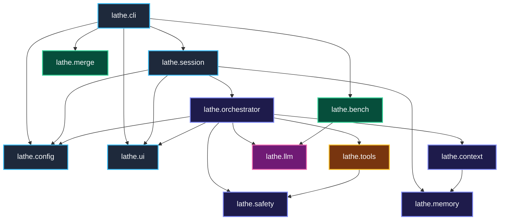

# Lathe Architecture

Lathe is an open-source terminal AI coding agent built around dual-model orchestration, local GGUF runtimes, and automated weight merging. This document details each architectural package and the internal dependency structure.

## Modules

### `lathe.cli`
The command-line interface entry point parsed via Typer and styled with Rich. It dispatches global options like `--version`, executes utility commands like `lathe doctor`, `lathe config`, and `lathe merge`, and triggers interactive or headless agent sessions.

### `lathe.config`
Configuration management system handling two-level TOML settings (global `~/.config/lathe/lathe.toml` and project `./lathe.toml`). It validates roles (planner, coder, reviewer, router) and operational parameters with Pydantic while isolating API tokens (`HF_TOKEN`) exclusively to environment variables.

### `lathe.session`
Manages the active developer session lifecycle. It maintains conversational state, registers active workspace settings, and serializes checkpoint history across agent interactions.

### `lathe.orchestrator`
The core agent reasoning and execution engine. It coordinates single-agent tool loops (`lathe.orchestrator.agent.Agent`), dual-model orchestration (`lathe.orchestrator.dual.DualAgent`), automated code review verification (`lathe.orchestrator.review.StepReviewer`), and intelligent task routing with per-role performance telemetry (`lathe.orchestrator.router.TaskRouter` and `StatsCollector`). The task router classifies user requests into three categories: `chat` (questions, explanations, greetings, no code changes), `simple` (localized single-file edits), or `complex` (multi-file changes, new features, refactoring, architectural overhaul). It evaluates cheap rule-based heuristics first (length, number of `@file` mentions, keywords like `refactor`, `build`, `migrate`), falling back to the router model with a tiny JSON prompt. Routing dispatches requests dynamically: `chat` routes to an agent restricted exclusively to read and search tools (`read_file`, `list_dir`, `glob`, `grep_search`, `semantic_search`), `simple` routes to single mode with the coder model, and `complex` routes to dual mode. It renders routing decisions in a dim indicator line (`routed: complex → dual mode`), allows manual override via `/mode single|dual|auto`, and powers cheap internal jobs (summaries for compaction, Conventional Commits messages, task titles). The `StatsCollector` tracks per-role telemetry (calls, input/output tokens, latency, tokens/sec), renders structured Rich inspection tables via `/stats`, and automatically serializes session metrics to `.lathe/sessions/<id>/stats.json`. The single-agent loop governs the coder model under system guidelines in `src/lathe/prompts/agent.md` (read before editing, make the smallest change, run tests after changes, never guess file contents, explain briefly then act), inspecting tool calls, validating permissions, snapshotting working tree checkpoints, executing parallel read tools, detecting call loops, enforcing step budgets, and offering an optional post-execution `self_check` that runs project tests and self-corrects failures. The dual-model orchestrator pairs a reasoning planner model with a code execution model: (1) the planner synthesizes tasks, repo maps, and code search results into Pydantic-validated JSON plans (`goal`, `steps`, `risks`) with automatic single-retry correction on malformed JSON; (2) the plan is presented as an interactive live checklist for user approval, `$EDITOR` JSON modification, or rejection; (3) each step runs the coder agent in a focused context containing only step instructions, target files, repo map, and prior step summaries; (4) after each step, the reviewer role (defaults to the planner model) evaluates the step diff and test suite results against the five review rubric criteria in `src/lathe/prompts/review.md` (correctness, matches the step, no unrelated changes, no secrets, tests pass), returning a structured JSON verdict (`approve` or `revise` with file, line, problem, and suggestion); (5) on `revise`, the coder retries the step with reviewer feedback (up to 2 retries), prompting the user with `[k]eep`, `[u]ndo this step`, or `[t]ake over` if retries exceed 2; (6) the planner reviews step outcomes to revise, reorder, or insert remaining steps. All loops stream decoupled events (`ThinkingEvent`, `ToolStartEvent`, `ToolEndEvent`, `DiffEvent`, `NudgeEvent`, `AgentHaltEvent`, `FinalAnswerEvent`, `PlanCreatedEvent`, `StepStartedEvent`, `StepDoneEvent`, `PlanRevisedEvent`, `StepReviewedEvent`) over `EventBus` to `TerminalAgentUI`, supporting both one-shot execution (`lathe "task"`, `lathe --dual "task"`) and REPL conversations toggled via `/mode single`, `/mode dual`, and `/mode auto`.

### `lathe.llm`
Unified provider abstraction layer handling prompt dispatch, streaming token generation, and response parsing. It abstracts local inference through Ollama (GGUF) and cloud inference via the Hugging Face Inference Providers API or OpenAI-compatible backends.

### `lathe.tools`
The sandboxed tool framework and registry. It defines the abstract `Tool` base class with Pydantic argument schemas auto-converted to JSON Schema, risk level classification (`read`, `write`, `execute`, `network`), structured error feedback for LLM self-correction, and configurable output truncation. It provides read-side and create-side workspace file tools (`read_file` with line numbering, binary detection, and size limits; `list_dir` with compact ASCII tree generation and depth limits; `glob` for pattern matching; `write_file` for creating new files with automatic parent directories and overwrite prevention), search tools (`grep_search` using ripgrep with pure Python fallback for exact/regex search with 2 lines of context; `semantic_search` for natural language conceptual queries against indexed vector chunks), the atomic `edit_file` tool supporting exact and whitespace-insensitive matching, ambiguous match detection with line numbers, multi-edit atomic rollback, unified diff generation, and encoding/newline (LF/CRLF) preservation, the `run_shell` execution tool that runs commands strictly in the workspace root, streams live standard output and error to the UI, enforces process group termination (`SIGKILL`) on timeout or cancellation, and truncates trailing output history, model git tools (`git_status`, `git_diff` staged/unstaged/path, `git_log`, `git_commit` with write authorization), and the `run_tests` tool (`RunTestsTool`) auto-detecting test runners (`pytest`, `npm test`, `pnpm test`, `yarn test`, `cargo test`, `go test ./...`, `ctest`, `make test`) or configured `[project].test_command` from `lathe.toml`, parsing pass/fail metrics and extracting the first failing test section for model self-correction. It provides the `@tool` decorator, `ToolRegistry`, and dual tool-calling protocols: native provider function calling and a fault-tolerant `<tool_call>` parser that handles messy model formatting (trailing commas, code fences, single quotes), selected dynamically from cached model capabilities.

### `lathe.context`
Responsible for token budgeting, workspace awareness, code structure indexing, semantic vector retrieval, and context compaction. It implements `lathe.context.repomap.RepoMap` using `tree-sitter` (`tree-sitter-language-pack`) to parse source code across Python, JavaScript/TypeScript, C/C++, Go, Rust, and Java into symbol definitions (classes, functions, methods, structs, interfaces, types) preserving signatures only without bodies, constructing a cross-file reference graph and ranking symbols via Personalized PageRank with power iteration ($d=0.85$). It also implements `lathe.context.index.CodeIndex` which chunks code by function/class via tree-sitter AST, generates normalized embeddings through Ollama (`nomic-embed-text`), local `sentence-transformers` (`BAAI/bge-small-en-v1.5`), or Hugging Face, stores vectors in `.lathe/index/code_index.db` (SQLite + numpy cosine similarity), performs incremental updates (re-embedding only modified chunks while reusing untouched chunk hashes), powers the `lathe index [--rebuild] [--stats]` CLI command with a Rich progress bar, and automatically refreshes stale files before semantic queries. Furthermore, it provides `lathe.context.budget.TokenCounter` for accurate token counting using model Hugging Face tokenizers via the `tokenizers` library with disk caching and heuristic fallback (`len(text)/3.5`), `BudgetAllocator` managing categorical shares (system: 10%, repomap: 15%, pinned files: 20%, conversation: 35%, tool results: 20%, reserving output capacity for model replies) and rendering visual colored bar charts, and two-stage compaction (`compact_context`) triggered at 75% capacity that compresses old tool outputs into one-line summaries and synthesizes older conversation history into a "session so far" note using the router model while strictly protecting the user's task, active plans, unresolved errors, and the latest 4 turns verbatim.

### `lathe.safety`
Permission engine, workspace boundary security system, and working tree checkpoints. It features the `Workspace` path security manager that resolves every path against the repository root, strictly prevents directory traversal attacks (`../`, absolute paths outside, symlinks pointing out), and respects `.gitignore` and `.latheignore` rules alongside default ignored directories (`node_modules`, `.venv`, `.git`, build directories). It includes the `PermissionEngine` enforcing a multi-tiered authorization hierarchy (`read` = auto-allow; `write`/`execute` = interactive prompt with `[y]es`, `[n]o`, `[a]lways for this pattern`, `[e]dit command`, and `[d]eny with message`). It persists wildcard rules in `.lathe/permissions.json`, purges sensitive secrets and API keys via environment scrubbing (`scrub_env`), enforces a regex-based hard security blocklist (`rm -rf /`, `rm -rf ~`, `sudo`, `mkfs`, raw device `dd`, `curl|sh`, `git push --force`, `chmod -R 777`, fork bombs) that cannot be bypassed even in `--yolo` mode, and supports `--auto` and `--yolo` operational flags. It includes the `CheckpointManager` that snapshots working trees before every mutating file tool or shell command into isolated refs (`refs/lathe/checkpoints/<session>/<n>`) using temporary indices (`git write-tree`/`commit-tree`) without touching the user's branch or index, providing non-destructive undo and restore, session diffs, and optional Conventional Commits auto-commit.

### `lathe.memory`
Short-term and compressed long-term memory engine. It maintains active execution scratchpads, caches AST symbol graphs, and performs lossless context compaction when conversation windows reach capacity.

### `lathe.ui`
Terminal presentation layer implemented with prompt_toolkit and Rich. It powers the interactive REPL with persistent history, Alt+Enter multiline editing, @file repository path autocompletion, dynamic bottom status bar toolbar (repository, git branch, mode, active role models, session tokens), slash command framework (/help, /model, /mode, /clear, /tokens, /compact, /exit, /undo, /checkpoints, /restore, /diff), unified theme palette (matching the README), and live streaming Markdown responses with syntax-highlighted code blocks and Ctrl+C generation cancellation.

### `lathe.merge`
Model combination pipeline integrating `mergekit` (optional extra: `lathe-agent[merge]`). It provides the `lathe merge` interactive wizard:
1. Model selection: supports tested presets (e.g. `Qwen/Qwen2.5-Coder-1.5B` + `Qwen/Qwen2.5-1.5B-Instruct` for laptops) or custom Hugging Face safetensors repositories (safetensors required; GGUF repositories strictly rejected).
2. Architecture compatibility checking: fetches remote `config.json` and `tokenizer_config.json` via `huggingface_hub` without downloading full model weights, comparing `model_type`, `hidden_size`, `num_hidden_layers`, `vocab_size`, and tokenizer specifications; renders structured Rich comparison tables and refuses incompatible model pairs.
3. Merge methods & YAML generation: generates validated mergekit YAML configurations saved into `merges/<name>/config.yaml` supporting SLERP (with parameter $t$ and optional layer-wise gradient for `self_attn` vs `mlp`), TIES and DARE-TIES (with designated base model, density, and weight coefficients), and Linear averaging.
4. Resource estimation: calculates parameter counts, computes FP16 memory requirements (`params * 2` bytes per model), checks available system RAM and disk capacity, and emits clear warnings when hardware limits are constrained.
5. Local execution & Model Cards: executes `mergekit-yaml` using lazy loading and low-memory flags (`--lazy-unpickle`, `--allow-crimes`, `--low-cpu-memory`, `--copy-tokenizer`), streaming real-time output, and auto-generates a comprehensive model card (`merges/<name>/README.md`) with YAML frontmatter, source model links, and GGUF deployment instructions.
6. Cloud execution: `lathe merge --colab` generates self-contained, GPU-accelerated Google Colab Jupyter notebooks (`.ipynb`) that install mergekit, execute the YAML configuration, and upload the merged weights directly to Hugging Face.
7. Hub publishing: `lathe merge push <name>` uploads merged directories to the Hugging Face Hub via `huggingface_hub.HfApi` with interactive confirmation and default private repository visibility.

### `lathe.bench`
Local evaluation harness assessing candidate model pairs on syntax accuracy, refactoring correctness, and unit test pass rates.

---

## Module Dependency Graph

