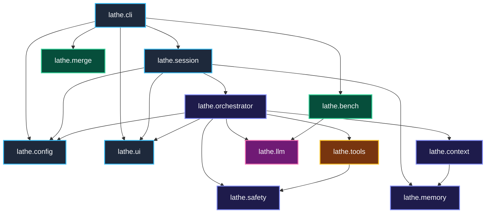

# Lathe Architecture

Lathe is an open-source terminal AI coding agent built around dual-model orchestration, local GGUF runtimes, and automated weight merging. This document details each architectural package and the internal dependency structure.

## Modules

### `lathe.cli`
The command-line interface entry point parsed via Typer and styled with Rich. It dispatches global options like `--version`, executes utility commands like `lathe doctor`, `lathe config`, and `lathe merge`, and triggers interactive or headless agent sessions.

### `lathe.config`
Configuration management system handling two-level TOML settings (global `~/.config/lathe/lathe.toml` and project `./lathe.toml`). It validates roles (planner, coder, reviewer, router) and operational parameters with Pydantic while isolating API tokens (`HF_TOKEN`) exclusively to environment variables.

### `lathe.session`
Manages the active developer session lifecycle. It maintains conversational state, registers active workspace settings, and serializes checkpoint history across agent interactions.

### `lathe.orchestrator`
The dual-LLM reasoning engine that decomposes high-level user tasks into sequential steps. It coordinates the Planner model (reasoning and diff review) with the Coder model (patch generation) in a closed verification loop.

### `lathe.llm`
Unified provider abstraction layer handling prompt dispatch, streaming token generation, and response parsing. It abstracts local inference through Ollama (GGUF) and cloud inference via the Hugging Face Inference Providers API or OpenAI-compatible backends.

### `lathe.tools`
The sandboxed tool framework and registry. It defines the abstract `Tool` base class with Pydantic argument schemas auto-converted to JSON Schema, risk level classification (`read`, `write`, `execute`, `network`), structured error feedback for LLM self-correction, and configurable output truncation. It provides read-side and create-side workspace file tools (`read_file` with line numbering, binary detection, and size limits; `list_dir` with compact ASCII tree generation and depth limits; `glob` for pattern matching; `write_file` for creating new files with automatic parent directories and overwrite prevention), each annotated with explicit LLM usage guidelines. It provides the `@tool` decorator, `ToolRegistry`, and dual tool-calling protocols: native provider function calling and a fault-tolerant `<tool_call>` parser that handles messy model formatting (trailing commas, code fences, single quotes), selected dynamically from cached model capabilities.

### `lathe.context`
Responsible for token budgeting and workspace awareness. It computes file embeddings, builds repository symbol maps, and strictly controls the 10/15/35/20/20 budget across system guidelines, AST maps, open files, dialogue, and tool logs.

### `lathe.safety`
Permission engine and workspace boundary security system. It features the `Workspace` path security manager that resolves every path against the repository root, strictly prevents directory traversal attacks (`../`, absolute paths outside, symlinks pointing out), and respects `.gitignore` and `.latheignore` rules alongside default ignored directories (`node_modules`, `.venv`, `.git`, build directories). It inspects every mutating or shell action before execution, enforcing read-only auto-approval, interactive prompts for file writes or test runs, and hard-blocking destructive shell invocations.

### `lathe.memory`
Short-term and compressed long-term memory engine. It maintains active execution scratchpads, caches AST symbol graphs, and performs lossless context compaction when conversation windows reach capacity.

### `lathe.ui`
Terminal presentation layer implemented with prompt_toolkit and Rich. It powers the interactive REPL with persistent history, Alt+Enter multiline editing, @file repository path autocompletion, dynamic bottom status bar toolbar (repository, git branch, mode, active role models, session tokens), slash command framework (/help, /model, /mode, /clear, /tokens, /exit), unified theme palette (matching the README), and live streaming Markdown responses with syntax-highlighted code blocks and Ctrl+C generation cancellation.

### `lathe.merge`
Model combination pipeline integrating `mergekit`. It builds SLERP and TIES interpolation configurations, converts safetensors via `llama.cpp`, quantizes models to Q4_K_M GGUF format, and generates Ollama Modelfiles.

### `lathe.bench`
Local evaluation harness assessing candidate model pairs on syntax accuracy, refactoring correctness, and unit test pass rates.

---

## Module Dependency Graph

