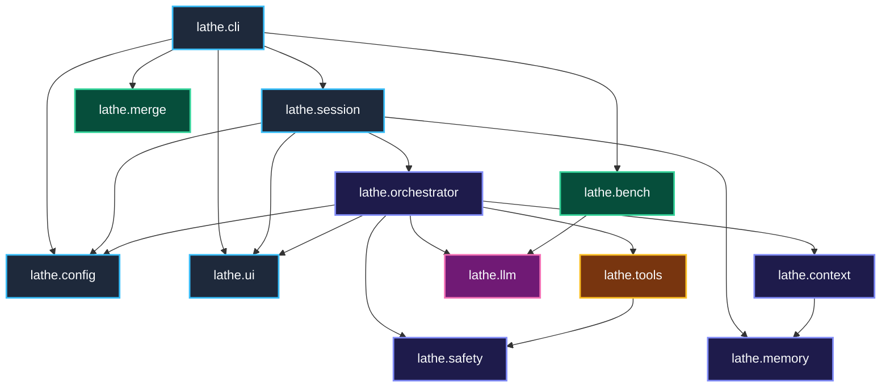

# Lathe Architecture

Lathe is an open-source terminal AI coding agent built around dual-model orchestration, local GGUF runtimes, and automated weight merging. This document details each architectural package and the internal dependency structure.

## Modules

### `lathe.cli`
The command-line interface entry point parsed via Typer and styled with Rich. It dispatches global options like `--version`, executes utility commands like `lathe doctor`, `lathe config`, and `lathe merge`, and triggers interactive or headless agent sessions.

### `lathe.config`
Configuration management system handling two-level TOML settings (global `~/.config/lathe/lathe.toml` and project `./lathe.toml`). It validates roles (planner, coder, reviewer, router) and operational parameters with Pydantic while isolating API tokens (`HF_TOKEN`) exclusively to environment variables.

### `lathe.session`
Manages the active developer session lifecycle. It maintains conversational state, registers active workspace settings, and serializes checkpoint history across agent interactions.

### `lathe.orchestrator`
The core agent reasoning and execution engine. It coordinates the coder model in an autonomous tool execution loop governed by system guidelines in `src/lathe/prompts/agent.md` (read before editing, make the smallest change, run tests after changes, never guess file contents, explain briefly then act). The loop inspects native tool calls and fallback `<tool_call>` blocks, validates permissions, snapshots non-destructive working tree checkpoints before mutations, executes multiple read-only tool calls concurrently in parallel turns, and appends structured tool results. It features built-in loop detection (injecting a repetition nudge at 3 identical tool calls and halting at 5) and enforces `max_agent_steps` limits (default 25). It is completely decoupled from presentation via a typed publish-subscribe event bus (`src/lathe/orchestrator/events.py`) emitting `ThinkingEvent`, `ToolStartEvent`, `ToolEndEvent`, `DiffEvent`, `NudgeEvent`, `AgentHaltEvent`, and `FinalAnswerEvent`. It powers both one-shot CLI execution (`lathe "task"`) and multi-turn interactive REPL conversations with rich terminal event rendering (`TerminalAgentUI`).

### `lathe.llm`
Unified provider abstraction layer handling prompt dispatch, streaming token generation, and response parsing. It abstracts local inference through Ollama (GGUF) and cloud inference via the Hugging Face Inference Providers API or OpenAI-compatible backends.

### `lathe.tools`
The sandboxed tool framework and registry. It defines the abstract `Tool` base class with Pydantic argument schemas auto-converted to JSON Schema, risk level classification (`read`, `write`, `execute`, `network`), structured error feedback for LLM self-correction, and configurable output truncation. It provides read-side and create-side workspace file tools (`read_file` with line numbering, binary detection, and size limits; `list_dir` with compact ASCII tree generation and depth limits; `glob` for pattern matching; `write_file` for creating new files with automatic parent directories and overwrite prevention), the atomic `edit_file` tool supporting exact and whitespace-insensitive matching, ambiguous match detection with line numbers, multi-edit atomic rollback, unified diff generation, and encoding/newline (LF/CRLF) preservation, the `run_shell` execution tool that runs commands strictly in the workspace root, streams live standard output and error to the UI, enforces process group termination (`SIGKILL`) on timeout or cancellation, and truncates trailing output history, and model git tools (`git_status`, `git_diff` staged/unstaged/path, `git_log`, `git_commit` with write authorization). It provides the `@tool` decorator, `ToolRegistry`, and dual tool-calling protocols: native provider function calling and a fault-tolerant `<tool_call>` parser that handles messy model formatting (trailing commas, code fences, single quotes), selected dynamically from cached model capabilities.

### `lathe.context`
Responsible for token budgeting and workspace awareness. It computes file embeddings, builds repository symbol maps, and strictly controls the 10/15/35/20/20 budget across system guidelines, AST maps, open files, dialogue, and tool logs.

### `lathe.safety`
Permission engine, workspace boundary security system, and working tree checkpoints. It features the `Workspace` path security manager that resolves every path against the repository root, strictly prevents directory traversal attacks (`../`, absolute paths outside, symlinks pointing out), and respects `.gitignore` and `.latheignore` rules alongside default ignored directories (`node_modules`, `.venv`, `.git`, build directories). It includes the `PermissionEngine` enforcing a multi-tiered authorization hierarchy (`read` = auto-allow; `write`/`execute` = interactive prompt with `[y]es`, `[n]o`, `[a]lways for this pattern`, `[e]dit command`, and `[d]eny with message`). It persists wildcard rules in `.lathe/permissions.json`, purges sensitive secrets and API keys via environment scrubbing (`scrub_env`), enforces a regex-based hard security blocklist (`rm -rf /`, `rm -rf ~`, `sudo`, `mkfs`, raw device `dd`, `curl|sh`, `git push --force`, `chmod -R 777`, fork bombs) that cannot be bypassed even in `--yolo` mode, and supports `--auto` and `--yolo` operational flags. It includes the `CheckpointManager` that snapshots working trees before every mutating file tool or shell command into isolated refs (`refs/lathe/checkpoints/<session>/<n>`) using temporary indices (`git write-tree`/`commit-tree`) without touching the user's branch or index, providing non-destructive undo and restore, session diffs, and optional Conventional Commits auto-commit.

### `lathe.memory`
Short-term and compressed long-term memory engine. It maintains active execution scratchpads, caches AST symbol graphs, and performs lossless context compaction when conversation windows reach capacity.

### `lathe.ui`
Terminal presentation layer implemented with prompt_toolkit and Rich. It powers the interactive REPL with persistent history, Alt+Enter multiline editing, @file repository path autocompletion, dynamic bottom status bar toolbar (repository, git branch, mode, active role models, session tokens), slash command framework (/help, /model, /mode, /clear, /tokens, /exit, /undo, /checkpoints, /restore, /diff), unified theme palette (matching the README), and live streaming Markdown responses with syntax-highlighted code blocks and Ctrl+C generation cancellation.

### `lathe.merge`
Model combination pipeline integrating `mergekit`. It builds SLERP and TIES interpolation configurations, converts safetensors via `llama.cpp`, quantizes models to Q4_K_M GGUF format, and generates Ollama Modelfiles.

### `lathe.bench`
Local evaluation harness assessing candidate model pairs on syntax accuracy, refactoring correctness, and unit test pass rates.

---

## Module Dependency Graph

