<div align="center">


[](https://python.org)
[](LICENSE)
[](https://ollama.ai)
[](https://huggingface.co)
[](CONTRIBUTING.md)
[](https://github.com)

</div>

Autonomous terminal coding agent combining open-source local LLMs, dual-model orchestration, and automated model merging.

---

## 🖥️ Terminal Experience

<div align="center">
  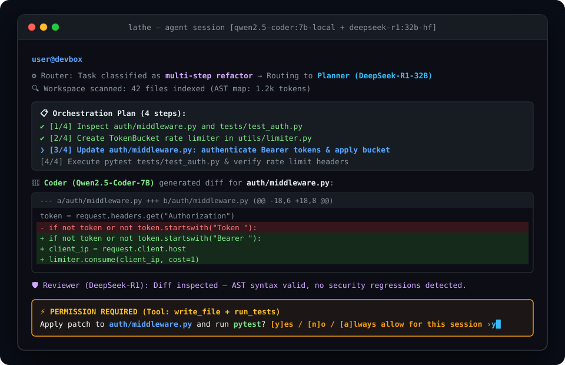
</div>

Interactive terminal interface with automated planning, structured diff generation, AST review, and permission prompts.

---

## 🗺️ Feature Architecture Map

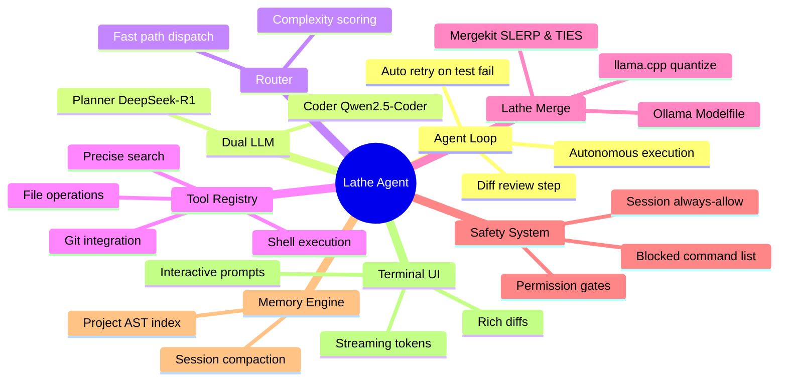
Complete feature landscape spanning autonomous orchestration, dual-model inference, and local tool execution.

---

## 🏗️ High-Level System Architecture

```mermaid
flowchart LR
    classDef cliStyle fill:#1e293b,stroke:#38bdf8,stroke-width:2px,color:#f8fafc;
    classDef coreStyle fill:#1e1b4b,stroke:#818cf8,stroke-width:2px,color:#f8fafc;
    classDef backendStyle fill:#701a75,stroke:#f472b6,stroke-width:2px,color:#f8fafc;
    classDef toolStyle fill:#78350f,stroke:#fbbf24,stroke-width:2px,color:#f8fafc;
    classDef envStyle fill:#064e3b,stroke:#34d399,stroke-width:2px,color:#f8fafc;

    subgraph Entry ["🖥️ Client Entry"]
        CLI["lathe CLI"]:::cliStyle
        Session["Session Manager"]:::cliStyle
    end

    subgraph Engine ["🧠 Orchestration Engine"]
        Router{"Task Router"}:::coreStyle
        Planner["Planner / Reviewer"]:::coreStyle
        Coder["Coder Model"]:::coreStyle
    end

    subgraph Backends ["🔌 LLM Providers"]
        Ollama["Ollama (Local GGUF)"]:::backendStyle
        HF["Hugging Face API"]:::backendStyle
        OpenAIComp["OpenAI-Compatible"]:::backendStyle
    end

    subgraph Tools ["🧰 Tool Registry"]
        Files["File System"]:::toolStyle
        Edit["Diff & Patch"]:::toolStyle
        Shell["Terminal Shell"]:::toolStyle
        Git["Git Actions"]:::toolStyle
        Search["AST & Grep"]:::toolStyle
        Tests["Test Runner"]:::toolStyle
    end

    Workspace[("📂 Project Workspace")]:::envStyle

    CLI --> Session
    Session --> Router
    Router --> Planner
    Router --> Coder
    Planner <--> Coder
    Planner --> Backends
    Coder --> Backends
    Planner --> Tools
    Coder --> Tools
    Tools --> Workspace
```
Modular decoupling of user sessions, multi-model orchestration, provider backends, and sandboxed workspace tools.

---

## 🔄 Autonomous Agent Loop

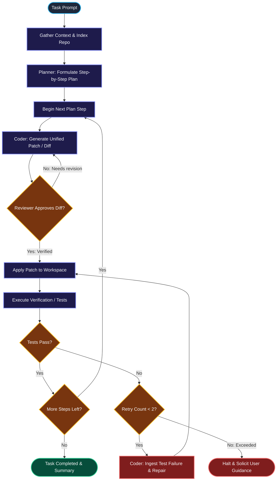
Closed-loop verification cycle enforcing dual-model review and automated test validation before each commit.

---

## 🤝 Task Handoff Lifecycle

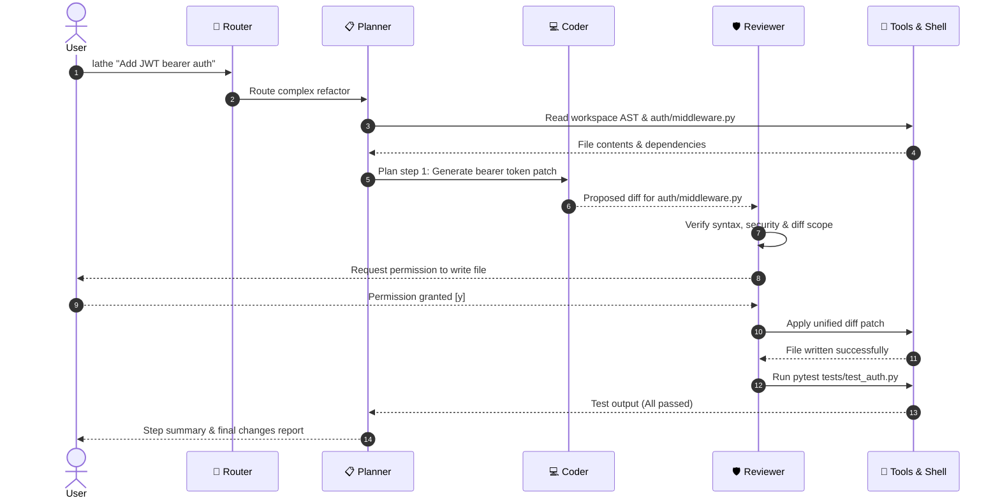
Step-by-step collaboration between user authorization, specialized LLM roles, and local filesystem tools.

---

## 🛡️ Permission & Safety State Machine

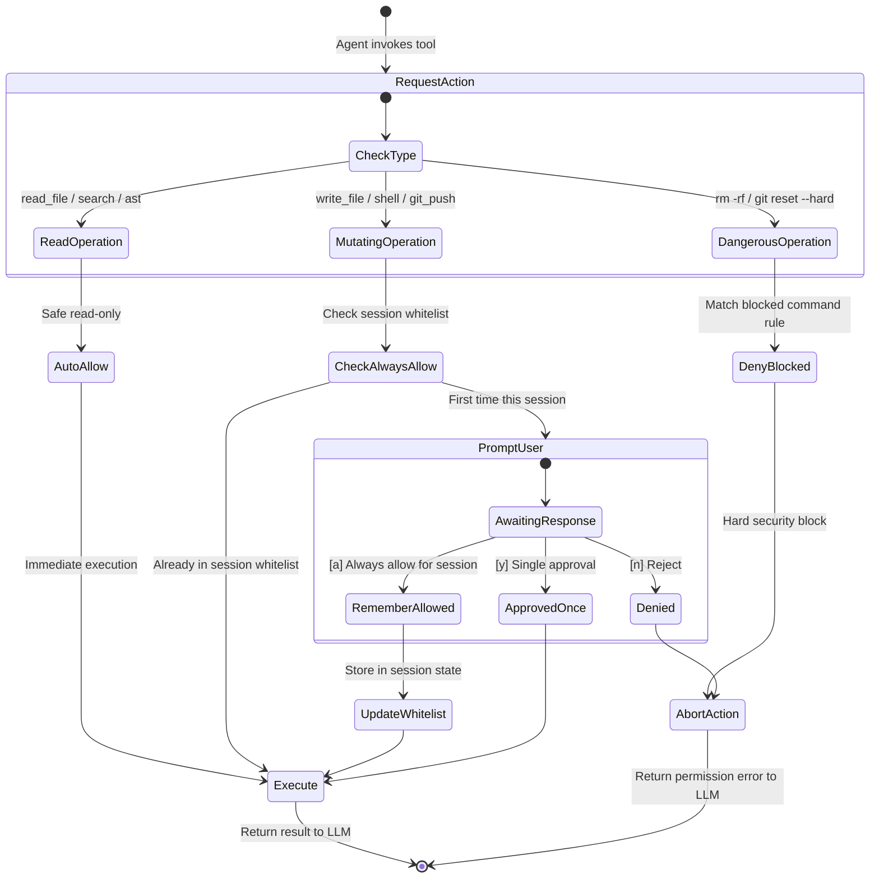
Multi-tiered authorization pipeline preventing destructive shell commands while streamlining trusted developer workflows.

---

## 🧬 `lathe merge` Model Pipeline

```mermaid
flowchart LR
    classDef hfStyle fill:#701a75,stroke:#f472b6,stroke-width:2px,color:#f8fafc;
    classDef mergeStyle fill:#064e3b,stroke:#34d399,stroke-width:2px,color:#f8fafc;
    classDef quantStyle fill:#1e1b4b,stroke:#818cf8,stroke-width:2px,color:#f8fafc;
    classDef deployStyle fill:#78350f,stroke:#fbbf24,stroke-width:2px,color:#f8fafc;

    subgraph HFModels ["🤗 Hugging Face Sources"]
        ModelA["Model A (HF Safetensors)"]:::hfStyle
        ModelB["Model B (HF Safetensors)"]:::hfStyle
    end

    subgraph MergekitEngine ["⚙️ mergekit Engine"]
        Config["mergekit YAML Config (SLERP / TIES)"]:::mergeStyle
        MergedFP16["Merged Model (16-bit Safetensors)"]:::mergeStyle
    end

    subgraph LlamaCpp ["📦 Conversion & Quantization"]
        Convert["llama.cpp convert-hf-to-gguf"]:::quantStyle
        Quantize["Quantize: Q4_K_M GGUF"]:::quantStyle
    end

    subgraph LocalServe ["🚀 Ollama Runtime"]
        Modelfile["Ollama Modelfile Generation"]:::deployStyle
        OllamaLoad["ollama create & serve"]:::deployStyle
        LatheBench["lathe bench evaluation"]:::deployStyle
    end

    ModelA --> Config
    ModelB --> Config
    Config --> MergedFP16
    MergedFP16 --> Convert
    Convert --> Quantize
    Quantize --> Modelfile
    Modelfile --> OllamaLoad
    OllamaLoad --> LatheBench
```
Automated pipeline merging weights from dual model checkpoints, converting to GGUF, and deploying to Ollama.

---

## ⚡ Decoder-Only Transformer Architecture

<div align="center">
  
</div>

Internal neural layer structure of autoregressive foundation models executing reasoning and code generation in Lathe.

---

## 📐 Weight Interpolation & Manifold Merging

<div align="center">
  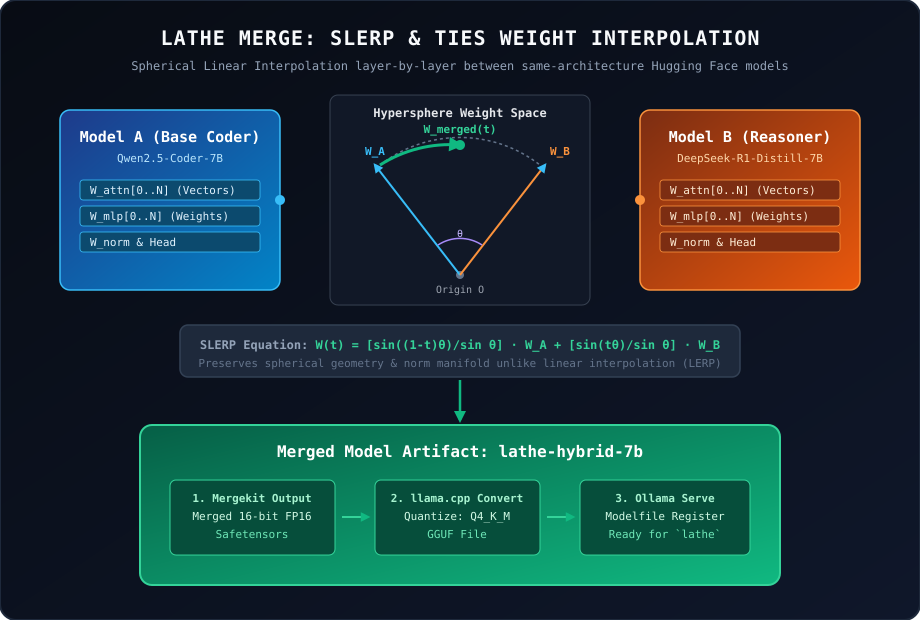
</div>

Spherical linear interpolation (SLERP) computing geodesic weight trajectories between reasoning and coding models.

---

## 📊 Model Selection Trade-Offs

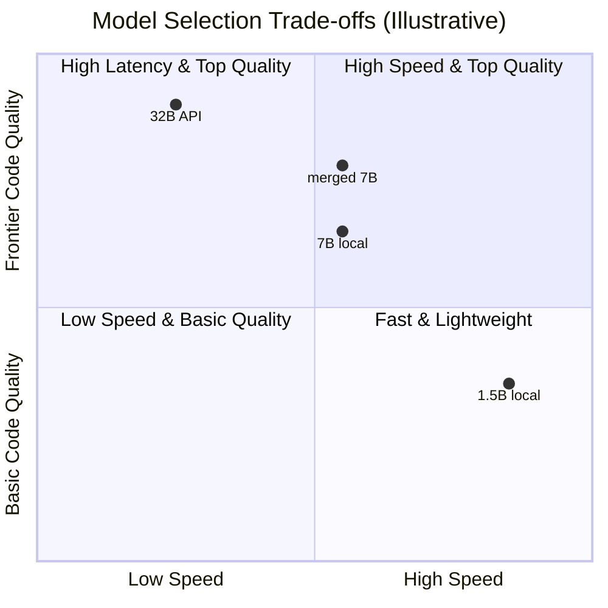
Qualitative balance between token throughput and code quality across local and cloud configurations.

---

## 🍰 Context Window Target Budget

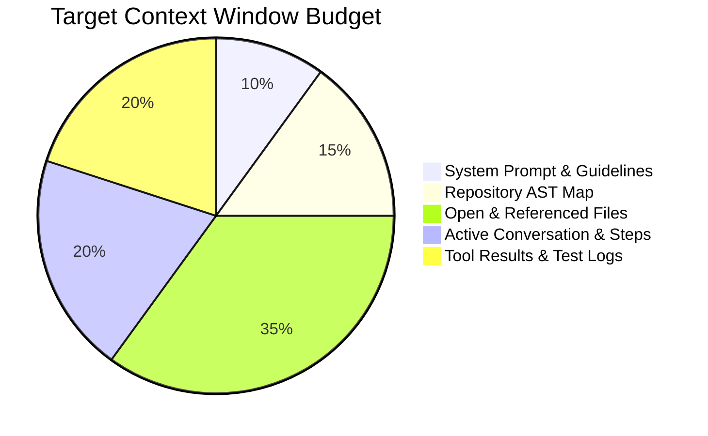
Recommended allocation preventing context starvation across file references, conversation history, and tool feedback.

---

## 📅 24-Phase Implementation Roadmap

```mermaid
gantt
    title Lathe 24-Phase Implementation Roadmap
    dateFormat X
    axisFormat Phase %s

    section Stage 1: Foundations
    Phase 1: Project Blueprint & Visual Specs :done, p1, 0, 1
    Phase 2: Configuration & CLI Shell :active, p2, 1, 2
    Phase 3: Ollama Local Runtime Client :p3, 2, 3
    Phase 4: HF Inference Providers Client :p4, 3, 4
    Phase 5: Tokenizer & Context Manager :p5, 4, 5

    section Stage 2: Tool Registry
    Phase 6: File System Tools :p6, 5, 6
    Phase 7: AST Symbol Graph & Repo Map :p7, 6, 7
    Phase 8: Unified Diff & Patch Engine :p8, 7, 8
    Phase 9: Sandboxed Shell Execution :p9, 8, 9
    Phase 10: Git Status & Branch Automation :p10, 9, 10
    Phase 11: Pytest Test Harness & Runner :p11, 10, 11

    section Stage 3: Agent Brain
    Phase 12: Prompt Templates & Personas :p12, 11, 12
    Phase 13: Core Orchestrator Loop :p13, 12, 13
    Phase 14: Step Planner & Decomposer :p14, 13, 14
    Phase 15: Automated Diff Reviewer :p15, 14, 15
    Phase 16: Failure Repair Loop & Retries :p16, 15, 16

    section Stage 4: Dual-LLM & Merge
    Phase 17: Complexity Task Router :p17, 16, 17
    Phase 18: Dual-Model Handshake Protocol :p18, 17, 18
    Phase 19: lathe mergekit Integrator :p19, 18, 19
    Phase 20: GGUF Quantization Pipeline :p20, 19, 20
    Phase 21: Model Evaluation & Benchmarks :p21, 20, 21

    section Stage 5: Ship It
    Phase 22: Session Memory & History Compaction :p22, 21, 22
    Phase 23: Rich Terminal UI & Streaming :p23, 22, 23
    Phase 24: End-to-End Hardening & Packaging :p24, 23, 24
```
Structured five-stage release plan advancing from core primitives to advanced multi-model merging and production distribution.

---

## 🌿 Phase Git Branching Strategy

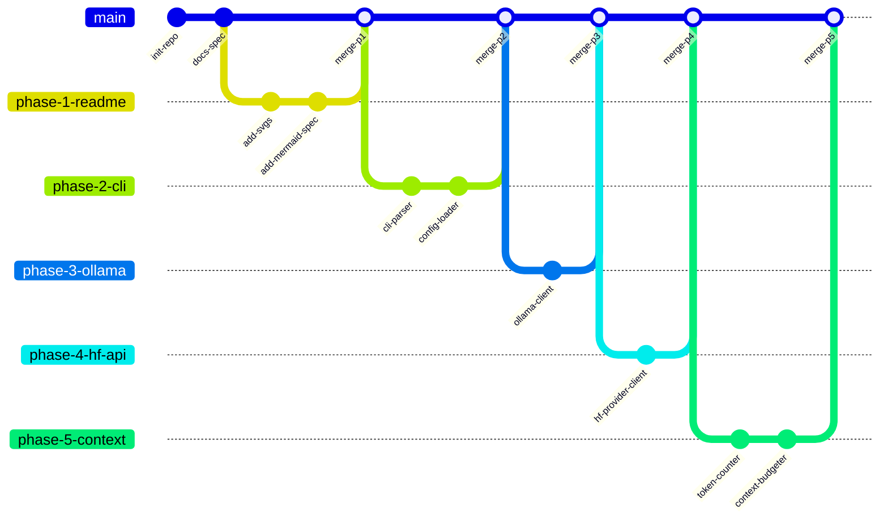
Isolated phase branches merging sequentially into main with end-to-end integration verification.

---

## 🎛️ Reference Tables & Structure

### 💻 CLI Commands

| ⚡ Command | 📝 Purpose | 🔧 Key Options |
|:---|:---|:---|
| `lathe` | Start interactive agent terminal session | `--model`, `--planner`, `--router` |
| `lathe "<prompt>"` | Run single prompt autonomously to completion | `--auto-approve`, `--max-steps 10` |
| `lathe --plan-only` | Analyze repository and print execution plan | `--output-plan plan.json` |
| `lathe merge` | Merge two Hugging Face models using mergekit | `--method slerp`, `--quant q4_k_m` |
| `lathe bench` | Evaluate model pair on local coding challenges | `--suite syntax,refactor,tests` |
| `lathe models` | List available local Ollama and Hugging Face models | `--download`, `--provider hf` |
| `lathe doctor` | Validate Ollama, llama.cpp, git, and HF tokens | `--fix` |

CLI interface for interactive coding, non-interactive CI automation, model merging, and diagnostics.

### ⌨️ In-Session Slash Commands

| 🪄 Command | 🎯 Action | 💡 Example |
|:---|:---|:---|
| `/help` | Display interactive command and tool reference | `/help tools` |
| `/plan` | Show current multi-step execution checklist | `/plan` |
| `/diff` | Inspect active pending diff before file write | `/diff auth/middleware.py` |
| `/run` | Execute shell or test command manually | `/run pytest -v` |
| `/compact` | Compact conversation history preserving AST context | `/compact` |
| `/model` | Switch active Planner, Coder, or Router model | `/model coder qwen2.5-coder:7b` |
| `/clear` | Clear terminal screen and temporary scratchpad | `/clear` |
| `/exit` | Gracefully terminate session and save progress | `/exit` |

Interactive commands available during agent execution sessions.

### ⚙️ Recommended Model Pairs by Hardware

| 🖥️ Hardware Tier | 🧭 Router Model | 📋 Planner / Reviewer | 💻 Coder Model | 🚀 Backend Mode |
|:---|:---|:---|:---|:---|
| **CPU Only (16GB RAM)** | `Qwen2.5-Coder-1.5B (Q4)` | `Qwen2.5-Coder-7B (Q4)` | `Qwen2.5-Coder-7B (Q4)` | Ollama Local |
| **6–8GB GPU (RTX 3060/4060)** | `Qwen2.5-Coder-1.5B (Q4)` | `DeepSeek-R1-Distill-7B (Q4)` | `Qwen2.5-Coder-7B (Q4)` | Ollama Local |
| **16GB+ GPU / Apple Silicon** | `Qwen2.5-Coder-7B (Q4)` | `DeepSeek-R1-Distill-14B (Q4)` | `Qwen2.5-Coder-14B (Q4)` | Ollama Local |
| **API Only / Hybrid** | Fast Local 1.5B or API | `DeepSeek-R1 (API)` | `Qwen2.5-Coder-32B-Instruct` | HF Inference Providers |
| **Lathe Merged** | Fast Local 1.5B | `lathe-hybrid-7b (SLERP)` | `lathe-hybrid-7b (SLERP)` | Ollama Local (Merged) |

Hardware-adapted configurations optimizing memory footprint, latency, and code accuracy.

### 📁 Project Folder Layout

```text
lathe/
├── assets/                  # High-resolution architectural and terminal SVGs
│   ├── banner.svg           # Project hero banner
│   ├── demo.svg             # Terminal workflow preview
│   ├── merge.svg            # SLERP weight interpolation schematic
│   └── transformer.svg      # Decoder-only transformer block diagram
├── lathe/                   # Core Python application package
│   ├── __init__.py          # Package entrypoint
│   ├── cli.py               # CLI parser and argument handler
│   ├── config.py            # Environment and config loader
│   ├── brain/               # Multi-model orchestrator
│   │   ├── planner.py       # Step decomposition and diff reviewer
│   │   ├── coder.py         # Code and patch generator
│   │   └── router.py        # Task complexity classifier
│   ├── engine/              # Autonomous execution loop
│   │   ├── loop.py          # State machine and retry engine
│   │   ├── memory.py        # Context budgeting and compaction
│   │   └── safety.py        # Permission gate and command filter
│   ├── providers/           # LLM API and local runtime connectors
│   │   ├── ollama.py        # Ollama local inference driver
│   │   └── huggingface.py   # Hugging Face Inference Providers API
│   ├── merge/               # Model merging and quantization
│   │   ├── mergekit.py      # SLERP / TIES config generator
│   │   ├── quantize.py      # llama.cpp GGUF converter
│   │   └── bench.py         # Verification and benchmark runner
│   ├── tools/               # Agent workspace capabilities
│   │   ├── files.py         # File read and write operations
│   │   ├── diff.py          # Unified diff parser and patcher
│   │   ├── shell.py         # Sandboxed process execution
│   │   ├── git.py           # Git status, checkout, and commit
│   │   ├── search.py        # AST indexer and symbol lookup
│   │   └── tests.py         # Pytest discovery and runner
│   └── ui/                  # Rich terminal user interface
│       ├── terminal.py      # Streaming renderer and color theme
│       └── prompt.py        # Interactive input and confirmation prompts
├── tests/                   # Automated pytest suite
├── .gitignore               # Ignored cache, models, and virtualenvs
├── LICENSE                  # Apache 2.0 license declaration
└── README.md                # Project documentation and visual architecture
```
Codebase hierarchy separating multi-model intelligence, provider drivers, and sandboxed tooling.

---

## 🚀 Quickstart

```bash
# 1. Install Lathe in your environment
pip install lathe-agent

# 2. Pull local coder model via Ollama
ollama pull hf.co/Qwen/Qwen2.5-Coder-7B-Instruct-GGUF:Q4_K_M

# 3. Configure Hugging Face token for router & reasoning API (optional)
export HF_TOKEN="hf_your_token_here"

# 4. Launch Lathe in any project workspace
lathe "Add JWT bearer auth & token rate limiter to auth/middleware.py"
```
Four simple steps to initialize your environment and launch an autonomous coding session.

---

## 🤝 Contributing & License

<div align="center">

[](LICENSE)
[](https://github.com)
[](CODE_OF_CONDUCT.md)

</div>

Distributed under the Apache 2.0 License. Built openly with the open-source AI community.
