<div align="center">

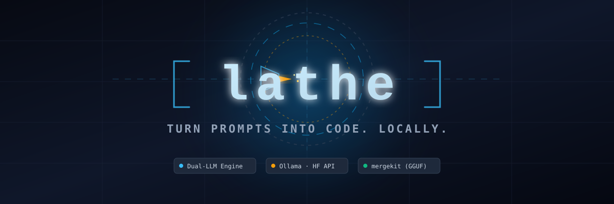

[](https://pypi.org/project/lathe-agent/)
[](https://pypi.org/project/lathe-agent/)
[](https://github.com/adityasurse/lathe/actions)
[](https://adityasurse.github.io/lathe/)
[](https://python.org)
[](LICENSE)
[](https://ollama.ai)
[](https://ai.google.dev/gemma)
[](https://huggingface.co)
[](CONTRIBUTING.md)

</div>

Autonomous terminal coding agent combining open-source local LLMs, dual-model orchestration, and automated model merging.

> 📖 **Complete Documentation**: Read the full [**Lathe User Manual (PDF)**](assets/manual/Lathe-User-Manual.pdf) (or browse online at [docs/manual/USER_MANUAL.md](docs/manual/USER_MANUAL.md)) for comprehensive hardware sizing guides, complete CLI & slash command reference tables, configuration specs, and architecture walkthroughs.

---

## Terminal Interface

<div align="center">
  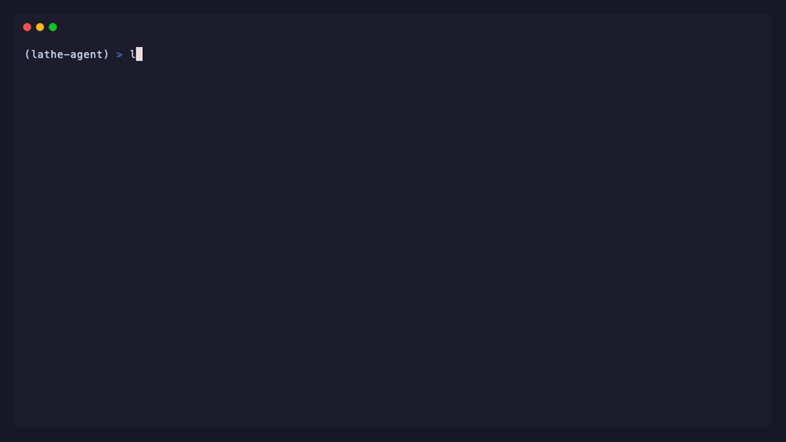
</div>

Interactive terminal interface with automated planning, structured diff generation, AST review, and permission prompts.

---

## Feature Map

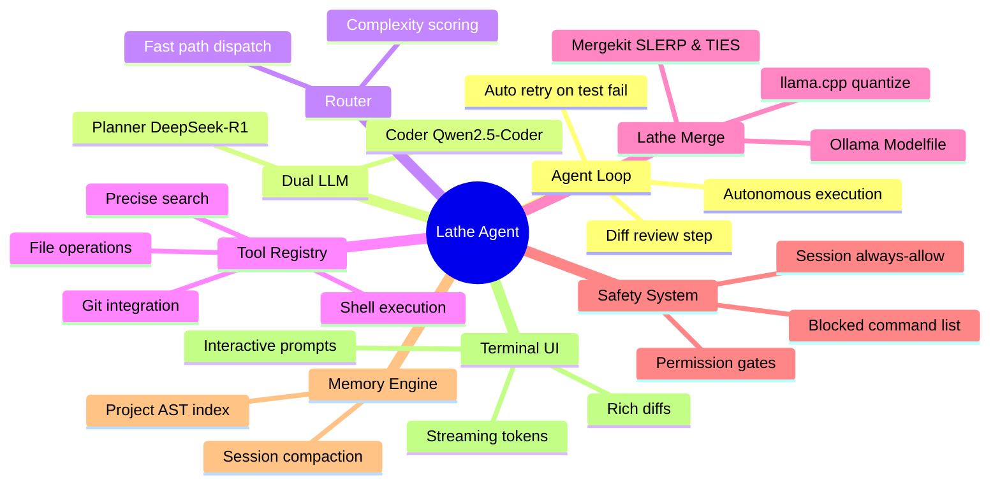
Complete feature landscape spanning autonomous orchestration, dual-model inference, and local tool execution.

---

## High-Level System Architecture

```mermaid
flowchart LR
    classDef cliStyle fill:#1e293b,stroke:#38bdf8,stroke-width:2px,color:#f8fafc;
    classDef coreStyle fill:#1e1b4b,stroke:#818cf8,stroke-width:2px,color:#f8fafc;
    classDef backendStyle fill:#701a75,stroke:#f472b6,stroke-width:2px,color:#f8fafc;
    classDef toolStyle fill:#78350f,stroke:#fbbf24,stroke-width:2px,color:#f8fafc;
    classDef envStyle fill:#064e3b,stroke:#34d399,stroke-width:2px,color:#f8fafc;

    subgraph Entry ["Client Entry"]
        CLI["lathe CLI"]:::cliStyle
        Session["Session Manager"]:::cliStyle
    end

    subgraph Engine ["Orchestration Engine"]
        Router{"Task Router"}:::coreStyle
        Planner["Planner / Reviewer"]:::coreStyle
        Coder["Coder Model"]:::coreStyle
    end

    subgraph Backends ["LLM Providers"]
        Ollama["Ollama (Local GGUF)"]:::backendStyle
        HF["Hugging Face API"]:::backendStyle
        OpenAIComp["OpenAI-Compatible"]:::backendStyle
    end

    subgraph Tools ["Tool Registry"]
        Files["File System"]:::toolStyle
        Edit["Diff & Patch"]:::toolStyle
        Shell["Terminal Shell"]:::toolStyle
        Git["Git Actions"]:::toolStyle
        Search["AST & Grep"]:::toolStyle
        Tests["Test Runner"]:::toolStyle
    end

    Workspace[("Project Workspace")]:::envStyle

    CLI --> Session
    Session --> Router
    Router --> Planner
    Router --> Coder
    Planner <--> Coder
    Planner --> Backends
    Coder --> Backends
    Planner --> Tools
    Coder --> Tools
    Tools --> Workspace
```
Modular decoupling of user sessions, multi-model orchestration, provider backends, and sandboxed workspace tools.

---

## Agent Loop


Closed-loop verification cycle enforcing dual-model review and automated test validation before each commit.

---

## Task Handoff Lifecycle

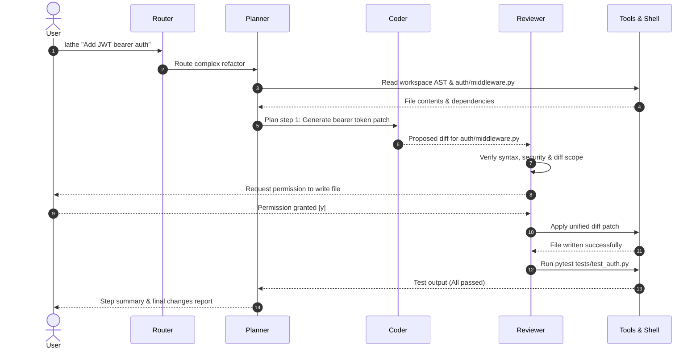
Step-by-step collaboration between user authorization, specialized LLM roles, and local filesystem tools.

---

## Permission & Safety System

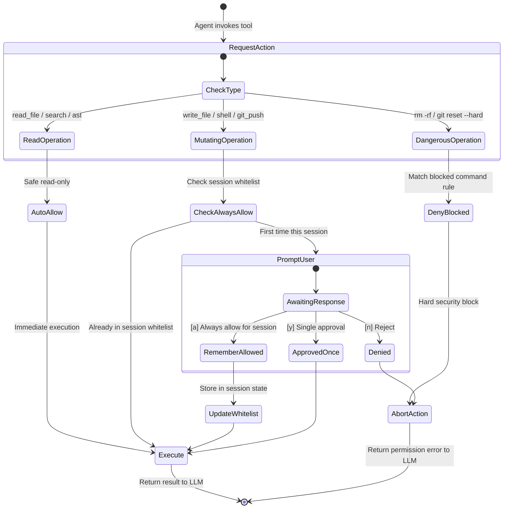
Multi-tiered authorization pipeline preventing destructive shell commands while streamlining trusted developer workflows.

---

## `lathe merge` Pipeline

```mermaid
flowchart LR
    classDef hfStyle fill:#701a75,stroke:#f472b6,stroke-width:2px,color:#f8fafc;
    classDef mergeStyle fill:#064e3b,stroke:#34d399,stroke-width:2px,color:#f8fafc;
    classDef quantStyle fill:#1e1b4b,stroke:#818cf8,stroke-width:2px,color:#f8fafc;
    classDef deployStyle fill:#78350f,stroke:#fbbf24,stroke-width:2px,color:#f8fafc;

    subgraph HFModels ["Hugging Face Sources"]
        ModelA["Model A (HF Safetensors)"]:::hfStyle
        ModelB["Model B (HF Safetensors)"]:::hfStyle
    end

    subgraph MergekitEngine ["mergekit Engine"]
        Config["mergekit YAML Config (SLERP / TIES)"]:::mergeStyle
        MergedFP16["Merged Model (16-bit Safetensors)"]:::mergeStyle
    end

    subgraph LlamaCpp ["Conversion & Quantization"]
        Convert["llama.cpp convert-hf-to-gguf"]:::quantStyle
        Quantize["Quantize: Q4_K_M GGUF"]:::quantStyle
    end

    subgraph LocalServe ["Ollama Runtime"]
        Modelfile["Ollama Modelfile Generation"]:::deployStyle
        OllamaLoad["ollama create & serve"]:::deployStyle
        LatheBench["lathe bench evaluation"]:::deployStyle
    end

    ModelA --> Config
    ModelB --> Config
    Config --> MergedFP16
    MergedFP16 --> Convert
    Convert --> Quantize
    Quantize --> Modelfile
    Modelfile --> OllamaLoad
    OllamaLoad --> LatheBench
```
Automated pipeline merging weights from dual model checkpoints, converting to GGUF, and deploying to Ollama.

---

## Decoder-Only Transformer Architecture

<div align="center">
  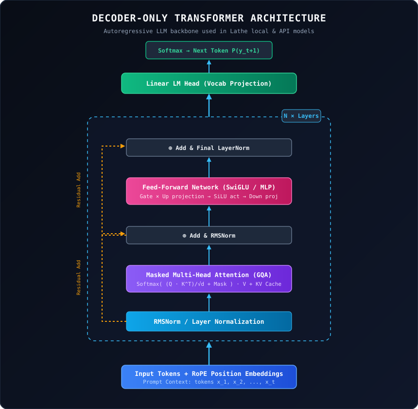
</div>

Internal neural layer structure of autoregressive foundation models executing reasoning and code generation in Lathe.

---

## Weight Interpolation & Manifold Merging

<div align="center">
  
</div>

Spherical linear interpolation (SLERP) computing geodesic weight trajectories between reasoning and coding models.

---

## Model Selection Trade-offs

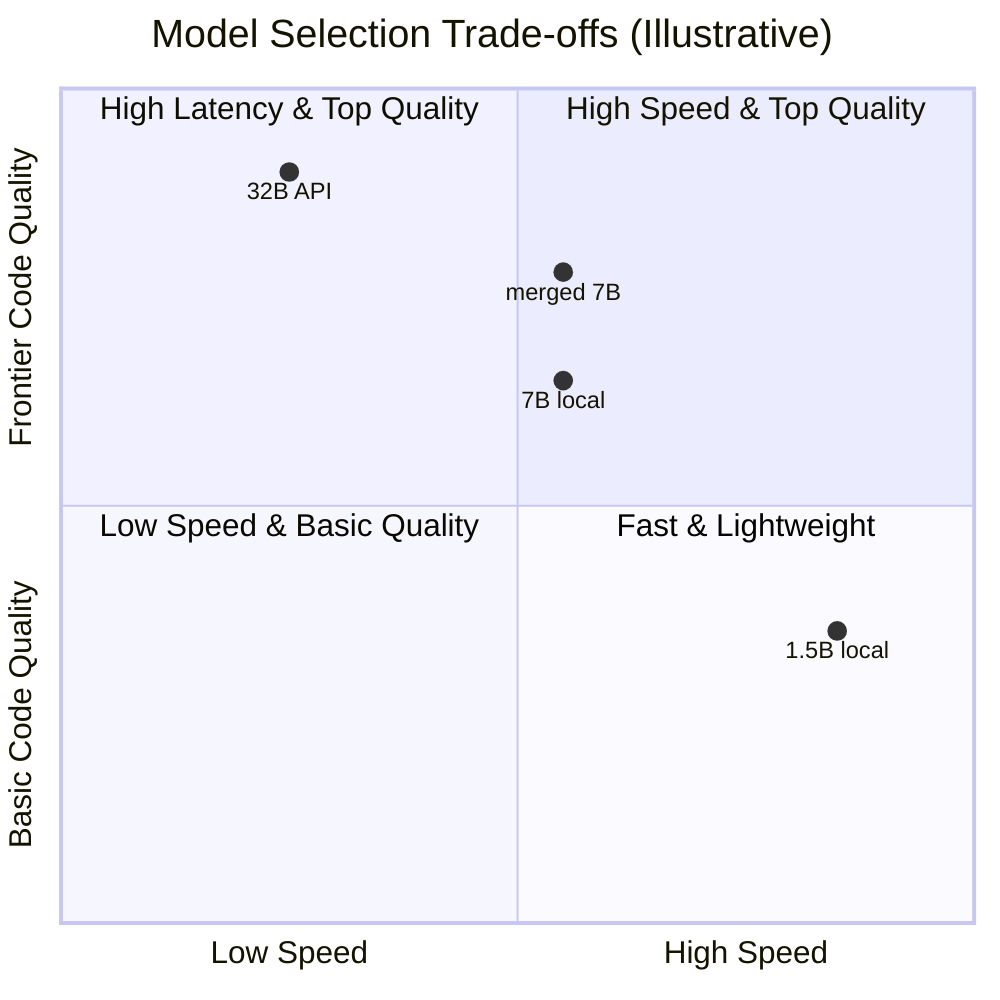
Qualitative balance between token throughput and code quality across local and cloud configurations.

---

## Context Window Budget

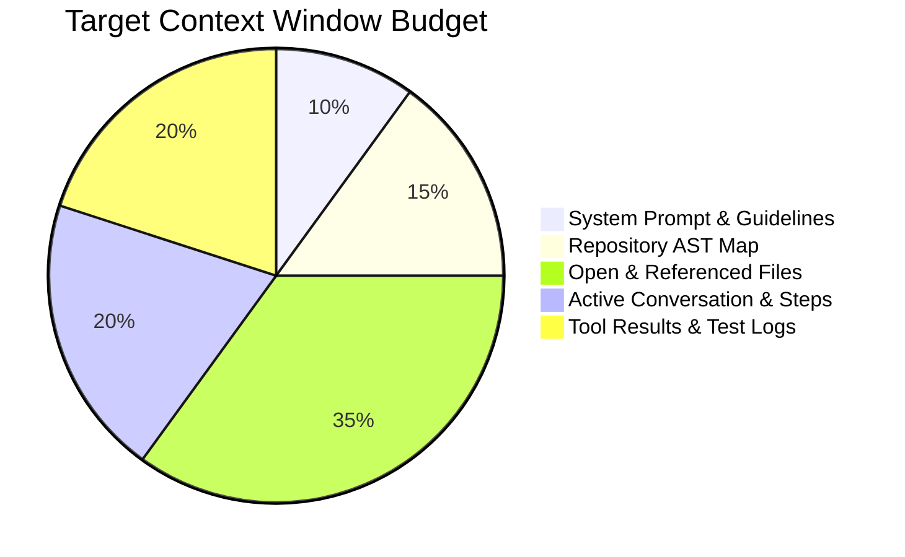
Recommended allocation preventing context starvation across file references, conversation history, and tool feedback.

---

## Implementation Roadmap

```mermaid
gantt
    title Lathe 24-Phase Implementation Roadmap
    dateFormat X
    axisFormat Phase %s

    section Stage 1: Foundations
    Phase 1: Project Blueprint & Visual Specs :done, p1, 0, 1
    Phase 2: Configuration & CLI Shell :active, p2, 1, 2
    Phase 3: Ollama Local Runtime Client :p3, 2, 3
    Phase 4: HF Inference Providers Client :p4, 3, 4
    Phase 5: Tokenizer & Context Manager :p5, 4, 5

    section Stage 2: Tool Registry
    Phase 6: File System Tools :p6, 5, 6
    Phase 7: AST Symbol Graph & Repo Map :p7, 6, 7
    Phase 8: Unified Diff & Patch Engine :p8, 7, 8
    Phase 9: Sandboxed Shell Execution :p9, 8, 9
    Phase 10: Git Status & Branch Automation :p10, 9, 10
    Phase 11: Pytest Test Harness & Runner :p11, 10, 11

    section Stage 3: Agent Brain
    Phase 12: Prompt Templates & Personas :p12, 11, 12
    Phase 13: Core Orchestrator Loop :p13, 12, 13
    Phase 14: Step Planner & Decomposer :p14, 13, 14
    Phase 15: Automated Diff Reviewer :p15, 14, 15
    Phase 16: Failure Repair Loop & Retries :p16, 15, 16

    section Stage 4: Dual-LLM & Merge
    Phase 17: Complexity Task Router :p17, 16, 17
    Phase 18: Dual-Model Handshake Protocol :p18, 17, 18
    Phase 19: lathe mergekit Integrator :p19, 18, 19
    Phase 20: GGUF Quantization Pipeline :p20, 19, 20
    Phase 21: Model Evaluation & Benchmarks :p21, 20, 21

    section Stage 5: Ship It
    Phase 22: Session Memory & History Compaction :p22, 21, 22
    Phase 23: Rich Terminal UI & Streaming :p23, 22, 23
    Phase 24: End-to-End Hardening & Packaging :p24, 23, 24
```
Structured five-stage release plan advancing from core primitives to advanced multi-model merging and production distribution.

---

## Git Branching Strategy

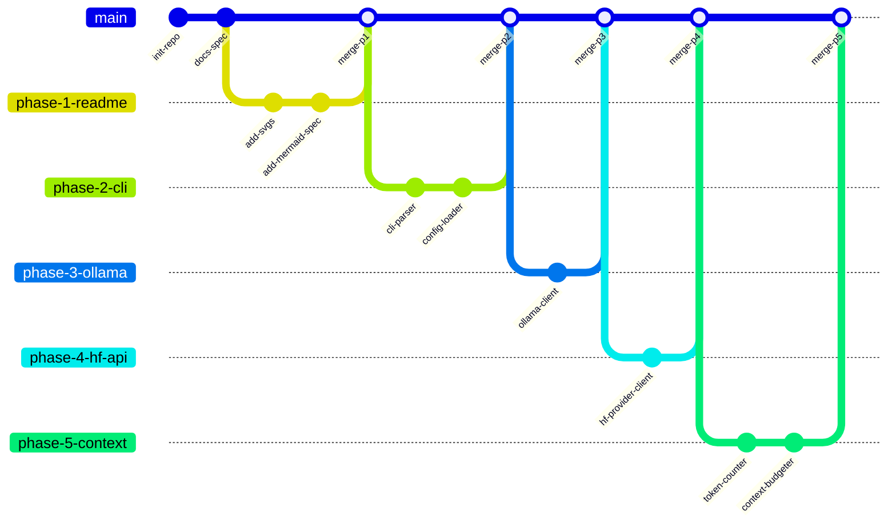
Isolated phase branches merging sequentially into main with end-to-end integration verification.

---

## Lathe Mini-Bench Results

<div align="center">
  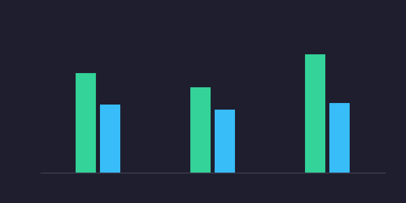
</div>

*Evaluated across 30 coding challenges (Python algorithms, C memory systems, and tool-call schema formatting). Results labeled under the Lathe mini-bench illustrative evaluation specification.*

---

## Reference Tables & Structure

### CLI Commands

| Command | Purpose | Key Options |
|:---|:---|:---|
| `lathe` | Start interactive agent terminal session | `--dual`, `--auto`, `--yolo` |
| `lathe "<task>"` | Run single prompt autonomously to completion | `--dual`, `--auto`, `--yolo`, `--max-steps 25` |
| `lathe doctor` | Validate Ollama runtime, git, tools, and HF tokens | |
| `lathe config [init\|show]` | Initialize or inspect `lathe.toml` configuration | `--path lathe.toml`, `--force` |
| `lathe models [list\|probe]` | Inspect local models and calibrate tool-calling protocol | `lathe models probe <model>` |
| `lathe merge [name]` | Interactive model merge wizard using mergekit | `--preset`, `--colab`, `--name <name>` |
| `lathe merge gguf <name>` | Convert safetensors to GGUF, quantize, and register in Ollama | `--quant Q4_K_M` |
| `lathe merge push <name>` | Upload merged model directory to Hugging Face Hub | `--repo-id <user/repo>` |
| `lathe bench [models...]` | Evaluate model candidates on Lathe mini-bench suite | `--tasks-dir`, `--output-json` |
| `lathe index` | Build or refresh AST symbol and vector code index | `--rebuild`, `--stats` |
| `lathe undo` | Revert workspace to previous checkpoint snapshot | |

CLI interface for interactive coding, non-interactive CI automation, model merging, and diagnostics.

### In-Session Slash Commands

| Command | Action | Example |
|:---|:---|:---|
| `/help` | Display interactive command and tool reference | `/help` |
| `/mode [single\|dual\|auto]` | Switch orchestrator execution mode | `/mode dual` |
| `/model [role] [model]` | Switch model assigned to coder, planner, reviewer, or router | `/model coder qwen2.5-coder:7b` |
| `/tokens` | Display colored breakdown chart of context budget | `/tokens` |
| `/compact` | Force compaction of older conversation turns | `/compact` |
| `/diff` | Inspect working tree unified diff since session start | `/diff` |
| `/checkpoints` | List checkpoint snapshot history | `/checkpoints` |
| `/undo` | Roll back recent agent edits to previous checkpoint | `/undo` |
| `/restore <n>` | Restore workspace to specific checkpoint number | `/restore 2` |
| `/remember <fact>` | Append convention or fact to `LATHE.md` | `/remember Always use ruff for linting` |
| `/init` | Explore repository and draft baseline `LATHE.md` | `/init` |
| `/stats` | View telemetry inspection table (latency, tokens/sec) | `/stats` |
| `/clear` | Clear terminal screen and temporary history | `/clear` |
| `/exit` | Gracefully terminate session and save progress | `/exit` |

Interactive commands available during agent execution sessions.

### Recommended Model Presets & Hardware Sizing

Lathe includes curated out-of-the-box presets for local open-source models:

| Preset Name | Coder Model | Router Model | Planner Model | Memory Footprint | Recommended Hardware |
|:---|:---|:---|:---|:---|:---|
| **`qwen`** *(Default)* | `Qwen2.5-Coder-7B (Q4)` | `Qwen2.5-Coder-1.5B (Q4)` | `DeepSeek-R1-Distill-7B (Q4)` | **~6.0 GB RAM** | 16GB+ Apple Silicon / RTX 3060+ |
| **`gemma`** *(Google)* | `gemma4:e4b (4B Q4)` | `gemma4:e2b (2B Q4)` | `gemma4:e4b (4B Q4)` | **~6.8 GB RAM** | 16GB+ Laptops & Workstations |
| **`mixed`** *(Hybrid)* | `Qwen2.5-Coder-7B (Q4)` | `gemma4:e2b (2B Q4)` | `DeepSeek-R1-Distill-7B (Q4)` | **~6.2 GB RAM** | 16GB+ RAM (Speed + Reasoning) |

---

### Using Google Gemma

Switch your active environment to Google Gemma in one command:

```bash
lathe models preset gemma
lathe
# or test with mini-bench: lathe bench --preset gemma --preset qwen
```

To switch back to Qwen at any time: `lathe models preset qwen`. Inspect all presets with `lathe models presets`.

---

### Project Folder Layout

```text
lathe/
├── assets/                  # High-resolution architectural diagrams, GIFs, and charts
│   ├── banner.svg           # Project hero banner
│   ├── demo.gif             # Live terminal workflow recording (VHS)
│   ├── bench.png            # Lathe mini-bench comparative metrics chart
│   ├── merge.svg            # SLERP weight interpolation schematic
│   └── transformer.svg      # Decoder-only transformer block diagram
├── docs/                    # Complete MkDocs documentation site
├── src/lathe/               # Core Python application package
│   ├── cli.py               # Typer CLI entrypoint and command router
│   ├── config.py            # TOML settings and role configuration
│   ├── orchestrator/        # Single-agent, dual-agent, reviewer, and task router
│   ├── tools/               # Sandboxed file, edit, shell, search, git, and test tools
│   ├── context/             # RepoMap AST parser, code index, and token budgeter
│   ├── safety/              # PermissionEngine, hard blocklist, and CheckpointManager
│   ├── memory/              # LATHE.md instructions, session state, and MCP client
│   ├── merge/               # mergekit wizard, GGUF converter, and Hugging Face publisher
│   ├── bench/               # Lathe mini-bench tasks and comparative report generator
│   └── ui/                  # prompt_toolkit REPL, Rich streaming, and commands
├── tests/                   # Comprehensive pytest test suite (80%+ coverage)
├── .github/                 # Workflows (ci.yml, docs.yml, release.yml), templates
├── install.sh               # Quick installer for Linux and macOS
├── install.ps1              # Quick installer for Windows PowerShell
├── demo.tape                # Charmbracelet VHS recording script
├── pyproject.toml           # Project metadata, dependencies, and build configuration
├── SECURITY.md              # Security policy, threat model, and vulnerability reporting
├── CONTRIBUTING.md          # Contribution guidelines and development workflow
├── CODE_OF_CONDUCT.md       # Contributor Covenant v2.1
├── CHANGELOG.md             # Keep a Changelog phase-by-phase history
└── README.md                # Project documentation and visual architecture
```
Codebase hierarchy separating multi-model intelligence, provider drivers, and sandboxed tooling.

---

## Installation & Quickstart

Install Lathe in under 2 minutes. For the complete step-by-step beginner walkthrough including RAM checks, hardware recommendations, speed optimizations, and troubleshooting:

📖 **Full step-by-step guide** → [assets/manual/Lathe-User-Manual.pdf](assets/manual/Lathe-User-Manual.pdf)

<details>
<summary><b>macOS</b></summary>

```bash
# 1. Install uv & Git developer tools
curl -LsSf https://astral.sh/uv/install.sh | sh
xcode-select --install

# 2. Install Lathe (latest development build)
uv tool install git+https://github.com/AdityaSurse/lathe
uv tool update-shell

# (Or install the stable PyPI release: uv tool install lathe-agent)

# 3. Install Ollama and pull local models
# Download Ollama from https://ollama.com/download or via Homebrew: brew install --cask ollama
ollama pull hf.co/bartowski/Qwen2.5-Coder-7B-Instruct-GGUF:Q4_K_M
ollama pull hf.co/Qwen/Qwen2.5-Coder-1.5B-Instruct-GGUF:Q4_K_M
ollama pull nomic-embed-text

# 4. Configure global preset and verify
lathe models preset qwen --global
lathe doctor

# 5. Launch in any git repository
cd my-project
lathe
```

</details>

<details>
<summary><b>Windows (PowerShell)</b></summary>

```powershell
# 1. Enable scripts & install uv and Git
Set-ExecutionPolicy -Scope CurrentUser RemoteSigned
powershell -ExecutionPolicy ByPass -c "irm https://astral.sh/uv/install.ps1 | iex"
winget install --id Git.Git -e

# 2. Install Lathe (latest development build)
uv tool install git+https://github.com/AdityaSurse/lathe
uv tool update-shell

# (Or install the stable PyPI release: uv tool install lathe-agent)

# 3. Install Ollama and pull local models
# Download Ollama from https://ollama.com/download/windows or via winget: winget install --id Ollama.Ollama -e
ollama pull hf.co/bartowski/Qwen2.5-Coder-7B-Instruct-GGUF:Q4_K_M
ollama pull hf.co/Qwen/Qwen2.5-Coder-1.5B-Instruct-GGUF:Q4_K_M
ollama pull nomic-embed-text

# 4. Configure global preset and verify
lathe models preset qwen --global
lathe doctor

# 5. Launch in any git repository
cd my-project
lathe
```

</details>

<details>
<summary><b>Linux</b></summary>

```bash
# 1. Install prerequisites & uv
sudo apt update && sudo apt install -y git curl
curl -LsSf https://astral.sh/uv/install.sh | sh

# 2. Install Lathe (latest development build)
uv tool install git+https://github.com/AdityaSurse/lathe
uv tool update-shell

# (Or install the stable PyPI release: uv tool install lathe-agent)

# 3. Install Ollama and pull local models
curl -fsSL https://ollama.com/install.sh | sh
ollama pull hf.co/bartowski/Qwen2.5-Coder-7B-Instruct-GGUF:Q4_K_M
ollama pull hf.co/Qwen/Qwen2.5-Coder-1.5B-Instruct-GGUF:Q4_K_M
ollama pull nomic-embed-text

# 4. Configure global preset and verify
lathe models preset qwen --global
lathe doctor

# 5. Launch in any git repository
cd my-project
lathe
```

</details>

### Quick Command Reference

```bash
# Interactive REPL session
lathe

# Single-shot autonomous task execution
lathe "Add JWT bearer auth & token rate limiter to auth/middleware.py"

# Dual-model planning and execution
lathe --dual "Refactor database connection pool across all services"
```

---

## Contributing & License

<div align="center">

[](LICENSE)
[](https://github.com)
[](CODE_OF_CONDUCT.md)

</div>

Distributed under the Apache 2.0 License. Built openly with the open-source AI community.

---

## Tutorial: your first 10 minutes with Lathe

Get started with Lathe on your codebase with this quick step-by-step walkthrough:

### 1. Install Lathe and verify your environment
Install the Lathe agent using `uv tool`:
```bash
uv tool install lathe-agent
```
Run diagnostic checks to verify Python (>=3.11), Git, Ollama runtime, and models:
```bash
lathe doctor
```
<div align="center">
  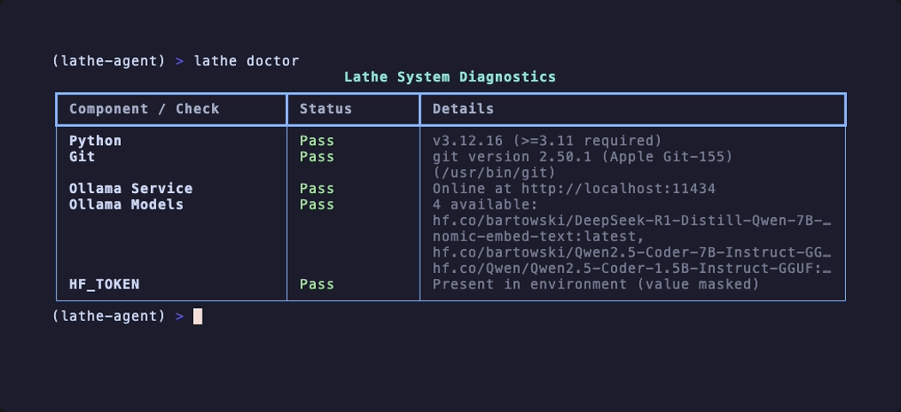
</div>

### 2. Launch an interactive session
Change directory to your project repository and open Lathe (or select your preferred model preset beforehand with `lathe models preset gemma` or `lathe models preset qwen`):
```bash
cd my-project
lathe
```
Lathe displays the startup banner with active models, current mode, and key shortcuts:
<div align="center">
  
</div>

### 3. Ask a question or explore code
Ask conceptual questions or locate functionality without mutating any files:
```text
lathe> Where are user permissions enforced and how does the blocklist work?
```
Lathe leverages fast read tools (`grep_search`, `read_file`) and answers directly.

### 4. Instruct the agent to make a change
Instruct Lathe to implement a new feature or fix a bug:
```text
lathe> Add input validation and error handling to src/auth.py
```
Before modifying any files, Lathe creates an isolated Git shadow checkpoint and prompts you for permission:
<div align="center">
  
</div>

### 5. Review the diff
Type `/diff` in the REPL to view the exact unified diff generated by Lathe:
```text
lathe> /diff
```
<div align="center">
  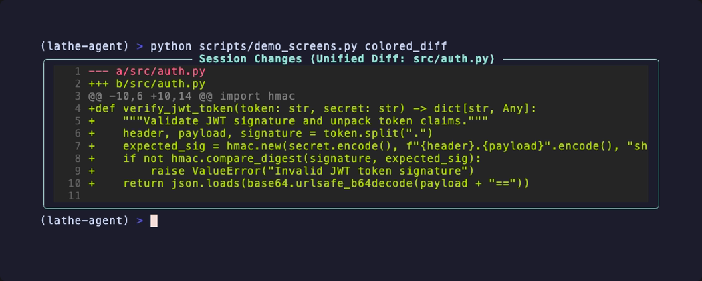
</div>

### 6. Undo changes instantly if needed
If you wish to discard changes and revert your workspace, simply type:
```text
lathe> /undo
```
Lathe restores your working directory to the exact state captured before the action was taken.

### 7. Try Dual Mode for multi-file refactoring
For complex features spanning multiple files, switch to Dual Mode:
```text
lathe> /mode dual
lathe> Implement JWT bearer token validation and add comprehensive pytest unit tests
```
The Planner model decomposes the goal into a live interactive checklist, the Coder executes each step in focused context, and the automated Reviewer validates diffs and unit tests before approval:
<div align="center">
  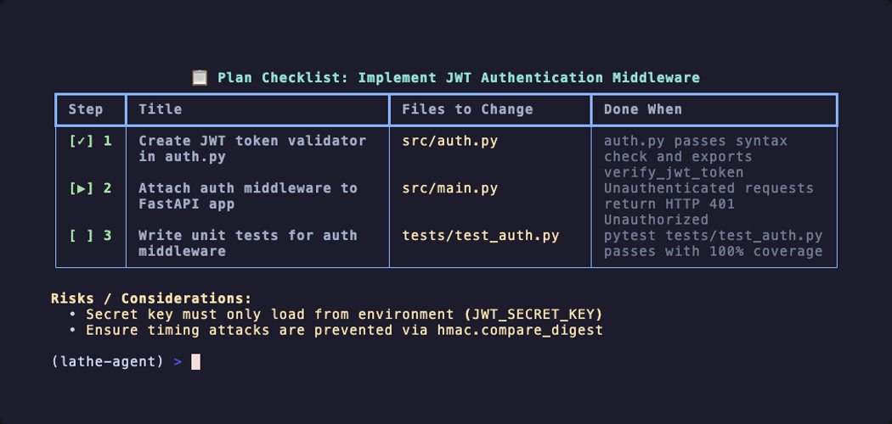
</div>

> 📚 For the complete guide to all 14 tools, 14 slash commands, model merging, and configuration options, see the [**Lathe User Manual (PDF)**](assets/manual/Lathe-User-Manual.pdf).
