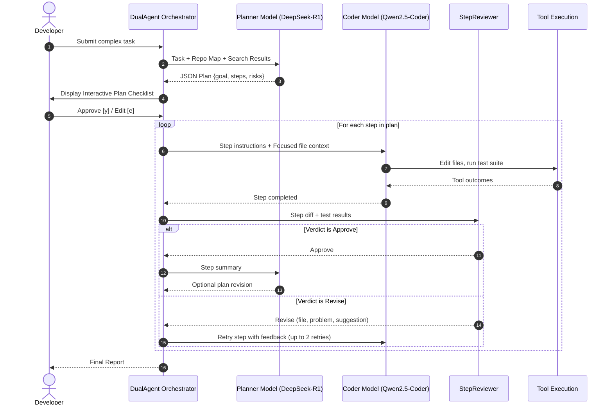

# Dual-LLM Mode

Dual-model orchestration pairs an expert software architect (**Planner**) with a disciplined execution specialist (**Coder**) to tackle complex multi-file refactoring and feature additions.

---

## Execution Flow



---

## 1. Structured Plan Generation

The planner model receives:
1. High-level task prompt
2. Project conventions from `LATHE.md`
3. Repository symbol map ranked by Personalized PageRank
4. Keyword and vector code search results

It produces a validated JSON execution plan conforming to Lathe's Pydantic schema:

```json
{
  "goal": "Add JWT authentication middleware and unit tests",
  "steps": [
    {
      "id": 1,
      "title": "Create auth configuration",
      "files_to_read": ["src/config.py"],
      "files_to_change": ["src/auth_config.py"],
      "instructions": "Implement AuthConfig loading JWT secret from environment",
      "done_when": "Unit tests pass"
    },
    {
      "id": 2,
      "title": "Add token validation middleware",
      "files_to_read": ["src/auth_config.py"],
      "files_to_change": ["src/middleware.py"],
      "instructions": "Extract Bearer tokens from Authorization headers",
      "done_when": "Integration test succeeds"
    }
  ],
  "risks": [
    "Token expiration edge case handling in expired sessions"
  ]
}
```

If the model produces malformed JSON, Lathe automatically feeds the validation error back for an immediate single-shot correction.

---

## 2. Interactive Checklist & User Approval

Before any code is altered, Lathe presents the plan in an interactive Rich terminal checklist:

- **`[y]es`**: Approve plan as written and begin automated step execution.
- **`[e]dit`**: Opens your `$EDITOR` (e.g. `nano`, `vim`, or `code`) on the raw plan JSON. Changes are validated upon save.
- **`[n]o`**: Reject the plan and return to prompt without modifying any files.

---

## 3. Focused Coder Execution

Unlike naive agents that dump entire conversation histories into context, Lathe runs the coder on a **focused context window** for each step:
- Only the active step's instructions and verification criteria (`done_when`)
- Pinned target files (`@file`)
- Repository symbol map
- Concise summaries of completed earlier steps

---

## 4. Step Review Rubric

After a step completes, the **StepReviewer** audits the unified git diff and test output against Lathe's five-point rubric:
1. **Correctness**: Does the code achieve the step objective without regressions?
2. **Step Match**: Does the change strictly implement the agreed step instructions?
3. **No Unrelated Changes**: Are modifications confined strictly to target files?
4. **No Secrets**: Are API keys, passwords, or tokens hardcoded?
5. **Tests Pass**: Did the automated test suite finish with zero failures?

If the review verdict is `revise`, the coder retries with specific line-by-line feedback. If retries exceed 2, the user is prompted to `[k]eep`, `[u]ndo this step`, or `[t]ake over`.
