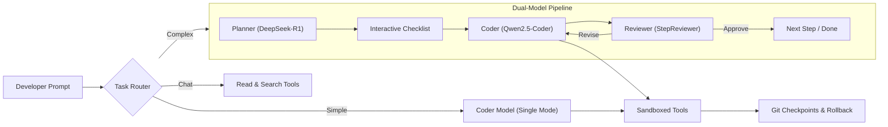

# Lathe

**Lathe** is an open-source terminal AI coding agent powered by dual-model orchestration, local GGUF runtimes, and automated weight merging.

---

## Key Highlights

- **Dual-Model Orchestration**: Pairs a deep reasoning model (e.g. `DeepSeek-R1`) for planning and code review with a high-throughput code specialist (e.g. `Qwen2.5-Coder`) for file edits and tool execution.
- **Local First, 100% Private**: Runs locally out-of-the-box with [Ollama](https://ollama.ai) or local inference servers. No code leaves your machine unless you configure remote backends.
- **Automated Model Merging**: Interactive `mergekit` wizard supporting SLERP, TIES, and DARE-TIES. Checks architecture compatibility, quantizes via `llama.cpp`, creates Ollama Modelfiles, and probes tool-calling accuracy.
- **Defense-in-Depth Safety**: Hard regex blocklist for catastrophic commands (`rm -rf /`, `sudo`, piped remote scripts), path traversal isolation, secret scrubbing (`scrub_env`), and instant git checkpoints (`/undo`).
- **AST Code Indexing & Semantic Search**: Tree-sitter AST parsing across Python, JavaScript/TypeScript, Go, Rust, and C/C++ with Personalized PageRank symbol ranking and local SQLite vector search.

---

## Architecture at a Glance



---

## Quick Start

```bash
# Install with uv tool (recommended)
uv tool install lathe-agent

# Run environment and model health check
lathe doctor

# Start interactive agent session
lathe
```
