# Lathe User Manual
**Autonomous Terminal AI Coding Agent Powered by Dual Open-Source Models & Automated Merging**

Version 0.1.0 · November 2026


---

## Table of Contents

1. [What is Lathe](#1-what-is-lathe)
2. [System Requirements](#2-system-requirements)
3. [Installation Guide](#3-installation-guide)
   - [macOS](#macos-installation)
   - [Linux](#linux-installation)
   - [Windows](#windows-installation)
   - [Verifying with lathe doctor](#verifying-with-lathe-doctor)
4. [Quick Start: First Session in 5 Minutes](#4-quick-start-first-session-in-5-minutes)
5. [Core Concepts](#5-core-concepts)
   - [Model Roles: Planner, Coder, Reviewer, Router](#model-roles)
   - [Execution Modes: Single, Dual, Auto](#execution-modes)
   - [Tools, Permissions, and Checkpoints](#tools-permissions-and-checkpoints)
6. [Feature Guide](#6-feature-guide)
   - [Interactive Terminal REPL](#interactive-terminal-repl)
   - [One-Shot Task Execution](#one-shot-task-execution)
   - [Dual-Model Orchestration](#dual-model-orchestration)
   - [Automated Code Reviewer & Retry Loop](#automated-code-reviewer--retry-loop)
   - [Intelligent Task Router](#intelligent-task-router)
   - [Workspace Tools: Read, Write, Edit, Shell, Git](#workspace-tools)
   - [Permission Engine & Always-Allow Rules](#permission-engine--always-allow-rules)
   - [Git Checkpoints & Instant Undo](#git-checkpoints--instant-undo)
   - [Tree-Sitter Repository Symbol Map](#tree-sitter-repository-symbol-map)
   - [Semantic Code Vector Indexing & Search](#semantic-code-vector-indexing--search)
   - [Context Budget Allocation & Automatic Compaction](#context-budget-allocation--automatic-compaction)
   - [Session Persistence & Resumption](#session-persistence--resumption)
   - [LATHE.md Project Memory](#lathemd-project-memory)
   - [Custom Slash Commands](#custom-slash-commands)
   - [Model Management: Search, Pull, Probe, Use](#model-management)
   - [Model Merging: SLERP, TIES, DARE & Colab Export](#model-merging)
   - [GGUF Conversion & Ollama Integration](#gguf-conversion--ollama-integration)
   - [Lathe Mini-Bench Evaluation Suite](#lathe-mini-bench-evaluation-suite)
   - [Model Context Protocol (MCP) Client](#model-context-protocol-mcp-client)
7. [Complete CLI Command Reference](#7-complete-cli-command-reference)
8. [Complete Slash Command Reference](#8-complete-slash-command-reference)
9. [Configuration Reference (lathe.toml)](#9-configuration-reference-lathetoml)
10. [Choosing & Sizing Models](#10-choosing--sizing-models)
11. [Safety, Threat Model & Blocked Commands](#11-safety-threat-model--blocked-commands)
12. [Troubleshooting & Error Recovery](#12-troubleshooting--error-recovery)
13. [Frequently Asked Questions (FAQ)](#13-frequently-asked-questions-faq)
14. [Keyboard Shortcuts](#14-keyboard-shortcuts)
15. [Glossary of Terms](#15-glossary-of-terms)

---

## 1. What is Lathe

**Lathe** is an open-source, local-first terminal AI coding agent (similar to Claude Code or Cursor Agent mode) designed to run autonomously against your codebase using local and open-source Large Language Models.

Unlike conventional cloud-tethered assistants, Lathe is architected around three foundational principles:

1. **Local Privacy & Zero Telemetry**: Your source code, file structures, and intellectual property remain entirely on your local workstation. Lathe sends zero telemetry, diagnostics, or tracking payloads to external servers.
2. **Dual-Model Specialization**: High-capacity reasoning models (such as `DeepSeek-R1` or large Qwen variants) construct structured, verifiable execution plans, while high-throughput coding models (such as `Qwen2.5-Coder-7B`) implement focused code changes with atomic file operations.
3. **Defense-in-Depth Safety Architecture**: Every workspace modification is preceded by an isolated Git shadow checkpoint. Dangerous shell patterns are blocked by hardcoded security filters, and all write operations require interactive authorization unless explicitly whitelisted.

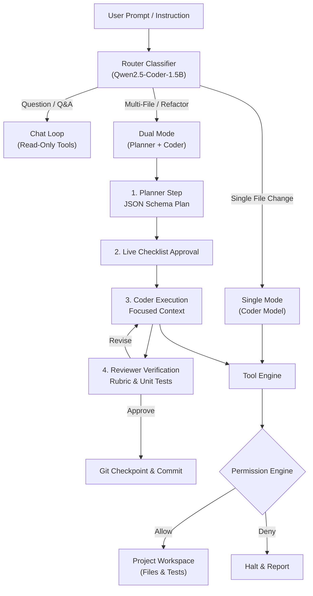

---

## 2. System Requirements

Lathe runs on standard modern desktop and server hardware. Because Lathe uses quantized GGUF models via Ollama or local Hugging Face checkpoints, memory requirements scale with your chosen model tier:

| Hardware Tier | Recommended RAM | Target Models | Supported Modes | Storage Needed |
| :--- | :--- | :--- | :--- | :--- |
| **Minimal / Laptop** | 8 GB Unified / RAM | `Qwen2.5-Coder-1.5B` (Router & Coder) | Single, Auto | 5 GB SSD |
| **Recommended** | 16 GB Unified / RAM | `Qwen2.5-Coder-7B` (Coder) + 1.5B (Router) + HF API Planner | Single, Dual, Auto | 15 GB SSD |
| **Heavy Workstation** | 32 GB – 64 GB+ RAM | `Qwen2.5-Coder-32B` (Coder) + `DeepSeek-R1-14B` (Planner) | Single, Dual, Auto | 45 GB SSD |
| **Cloud API Only** | 4 GB RAM | Any Hugging Face / OpenAI-compatible endpoint | Single, Dual, Auto | 1 GB SSD |

### Operating System & Runtime Support
- **macOS**: macOS 12 (Monterey) or later on Apple Silicon (M1/M2/M3/M4) or Intel x86_64. Metal GPU acceleration is supported automatically via Ollama.
- **Linux**: Ubuntu 20.04+, Debian 11+, Fedora 38+, Arch Linux, or any modern Linux distribution with glibc >= 2.31. NVIDIA CUDA and AMD ROCm acceleration supported via Ollama.
- **Windows**: Windows 10/11 64-bit via PowerShell 7+ or Windows Subsystem for Linux (WSL2).
- **Python**: Python 3.11, 3.12, or 3.13 (Python 3.10 and earlier are not supported).
- **Git**: Git 2.30+ installed and available on your system `PATH`.
- **Internet Access**: Required only for initial tool installation and downloading model weights. Once downloaded, local execution is 100% offline.

---

## 3. Installation Guide

Lathe is packaged as a standalone Python distribution installable with Astral's ultra-fast `uv` package manager, `pipx`, or standard shell one-liners.

### macOS Installation

1. **Install Homebrew and uv** (if not already installed):
   ```bash
   # Install uv via Homebrew or official Astral script
   brew install uv
   # Or: curl -LsSf https://astral.sh/uv/install.sh | sh
   ```

2. **Install Lathe Tool**:
   ```bash
   uv tool install lathe-agent
   ```
   *(To install with model merging and sentence-transformer embeddings extras:)*
   ```bash
   uv tool install "lathe-agent[merge,embeddings]"
   ```

3. **Install and Start Ollama**:
   ```bash
   brew install --cask ollama
   # Launch Ollama in the background
   ollama serve
   ```

4. **Pull Recommended Models**:
   ```bash
   # Primary Coder model (7B GGUF single-file quant)
   ollama pull hf.co/bartowski/Qwen2.5-Coder-7B-Instruct-GGUF:Q4_K_M

   # Lightweight Router model (1.5B GGUF)
   ollama pull hf.co/Qwen/Qwen2.5-Coder-1.5B-Instruct-GGUF:Q4_K_M

   # Fast embeddings model for semantic code search
   ollama pull nomic-embed-text
   ```

5. **(Optional) Configure Hugging Face API Token**:
   If using cloud-hosted inference for deep reasoning planner models (e.g. `DeepSeek-R1`), obtain a free access token from [Hugging Face Settings](https://huggingface.co/settings/tokens) and export it:
   ```bash
   echo 'HF_TOKEN="hf_your_personal_access_token_here"' >> ~/.zshrc
   source ~/.zshrc
   ```

---

### Linux Installation

1. **Install uv**:
   ```bash
   curl -LsSf https://astral.sh/uv/install.sh | sh
   export PATH="$HOME/.local/bin:$PATH"
   ```

2. **Install Lathe**:
   ```bash
   uv tool install lathe-agent
   ```

3. **Install Ollama**:
   ```bash
   curl -fsSL https://ollama.com/install.sh | sh
   ```

4. **Pull Default Models**:
   ```bash
   ollama pull hf.co/bartowski/Qwen2.5-Coder-7B-Instruct-GGUF:Q4_K_M
   ollama pull hf.co/Qwen/Qwen2.5-Coder-1.5B-Instruct-GGUF:Q4_K_M
   ollama pull nomic-embed-text
   ```

---

### Windows Installation

1. **Install uv via PowerShell**:
   Open Windows PowerShell (Run as Administrator or standard user) and execute:
   ```powershell
   powershell -ExecutionPolicy ByPass -c "irm https://astral.sh/uv/install.ps1 | iex"
   ```

2. **Install Lathe Tool**:
   ```powershell
   uv tool install lathe-agent
   ```

3. **Install Ollama for Windows**:
   Download and install the official Windows setup from [ollama.com/download/windows](https://ollama.com/download/windows).

4. **Pull Models in PowerShell**:
   ```powershell
   ollama pull hf.co/bartowski/Qwen2.5-Coder-7B-Instruct-GGUF:Q4_K_M
   ollama pull hf.co/Qwen/Qwen2.5-Coder-1.5B-Instruct-GGUF:Q4_K_M
   ollama pull nomic-embed-text
   ```

5. **(Optional) Set Hugging Face Token in PowerShell**:
   ```powershell
   [System.Environment]::SetEnvironmentVariable('HF_TOKEN', 'hf_your_token_here', 'User')
   ```

---

### Verifying with lathe doctor

Lathe includes a built-in diagnostic suite that validates your runtime environment, local models, Git installation, and API keys.

Run:
```bash
lathe doctor
```

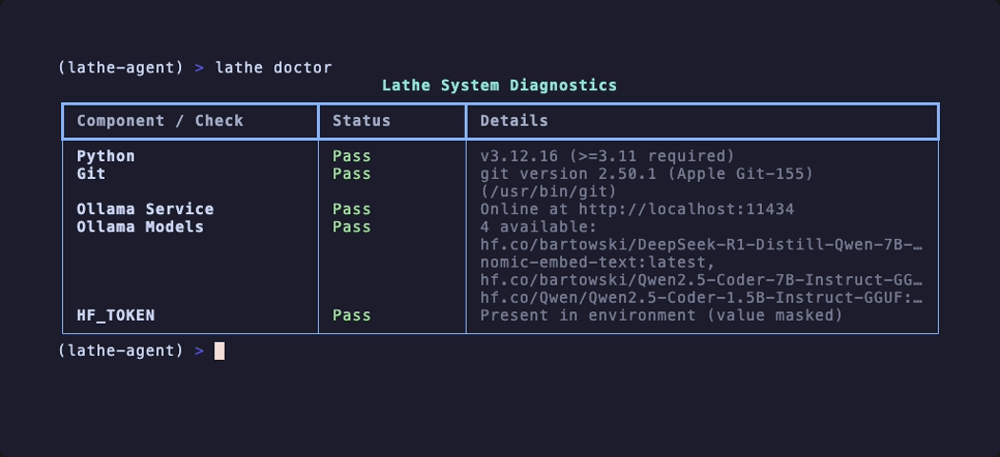

A healthy system displays:
- **Python**: Pass (v3.11, v3.12, or v3.13)
- **Git**: Pass (executable discovered)
- **Ollama Service**: Pass (reachable at `http://localhost:11434`)
- **Ollama Models**: Pass (detected coder and router models)
- **HF_TOKEN**: Pass (masked token loaded from environment)

---

## 4. Quick Start: First Session in 5 Minutes

Navigate to any existing code repository or create a clean testing folder:

```bash
mkdir demo-app && cd demo-app
git init
echo "# Demo Application" > README.md
git add README.md && git commit -m "Initial commit"
```

### 1. Launch the Lathe REPL
Run plain `lathe` in your terminal:
```bash
lathe
```
Lathe presents the interactive welcome banner with active models, routing mode, and token limits:

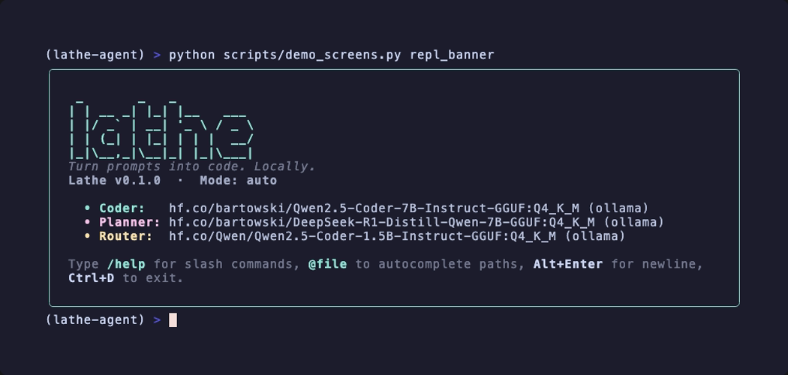

### 2. Inspect Available Slash Commands
Type `/help` to view all built-in commands:
```text
lathe> /help
```

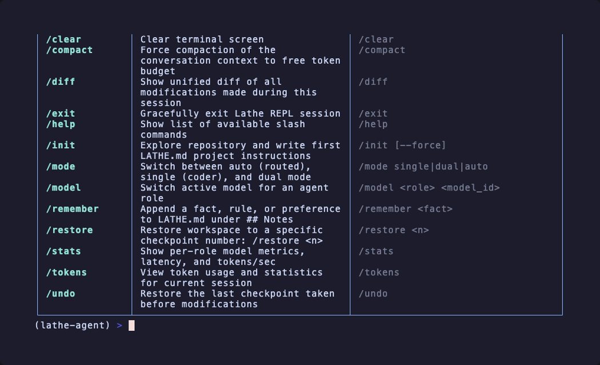

### 3. Ask a Question or Instruct the Agent
Instruct Lathe to generate a new utility module:
```text
lathe> Create a calculator module in src/calc.py with add, subtract, multiply, divide, and full docstrings.
```
Lathe will:
1. Classify the task (routed: `simple` → Single mode).
2. Create a Git shadow checkpoint (`#1 before write_file`).
3. Display an interactive authorization prompt before creating `src/calc.py`.
4. Prompt you to approve (`y`), deny (`n`), or always-allow (`a`).

### 4. Review Changes & Rollback
Type `/diff` to inspect the exact unified diff generated by Lathe:
```text
lathe> /diff
```

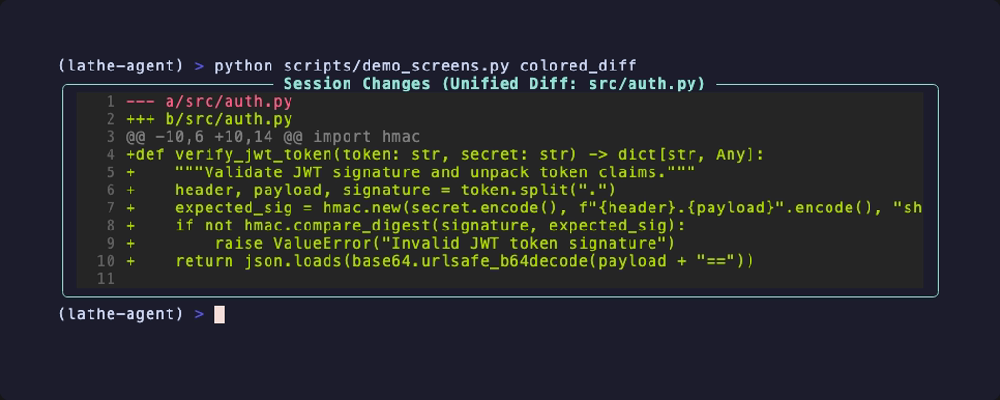

If you wish to discard changes immediately, type:
```text
lathe> /undo
```
Lathe restores your working directory to the exact state captured in checkpoint `#1`.

---

## 5. Core Concepts

### Model Roles

Lathe breaks agentic problem-solving into four dedicated roles configured under `[roles]` in `lathe.toml`:

```
┌─────────────────────────────────────────────────────────────┐
│                          ROUTER                             │
│       Classifies intent: chat, simple, or complex           │
└──────────────┬──────────────────────────────┬───────────────┘
               │                              │
       (Simple Task)                   (Complex Task)
               ▼                              ▼
┌─────────────────────────────┐┌──────────────────────────────┐
│           CODER             ││           PLANNER            │
│  Atomic file edits, shell   ││ Decomposes task into steps,  │
│  execution, focused context ││ identifies risks & criteria  │
└─────────────────────────────┘└──────────────┬───────────────┘
                                              │
                                              ▼
                               ┌──────────────────────────────┐
                               │           REVIEWER           │
                               │ Verifies diff against rubric │
                               │ and executes test suite      │
                               └──────────────────────────────┘
```

1. **Planner (`roles.planner`)**: High-parameter reasoning model (default: `deepseek-ai/DeepSeek-R1` via Hugging Face Inference API). Formulates a multi-step Pydantic-validated plan specifying target files, dependencies, instructions, and acceptance criteria.
2. **Coder (`roles.coder`)**: Fast, accurate code generation model (default: `hf.co/bartowski/Qwen2.5-Coder-7B-Instruct-GGUF:Q4_K_M` via Ollama). Operates on a focused per-step context to make atomic file modifications and execute commands.
3. **Reviewer (`roles.reviewer`)**: Quality assurance role (defaults to the Planner model if not explicitly configured). Evaluates code diffs and test results against strict rubrics after each step.
4. **Router (`roles.router`)**: Fast, lightweight model (default: `hf.co/Qwen/Qwen2.5-Coder-1.5B-Instruct-GGUF:Q4_K_M` via Ollama). Classifies incoming tasks, performs context compaction summaries, drafts commit messages, and formats session titles.

### Execution Modes

- **`auto` (Default)**: Lathe uses fast heuristics and the router model to categorize prompts into:
  - `chat`: General questions or explanations (no mutation tools allowed).
  - `simple`: Single-file modifications executed directly by the Coder.
  - `complex`: Multi-file features or refactorings executed in Dual mode.
- **`single`**: Every prompt is executed directly by the Coder model in a single autonomous agent loop.
- **`dual`**: Every task is first passed to the Planner to generate an interactive checklist, executed step-by-step by the Coder, and verified by the Reviewer.

Switch modes on the fly using `/mode single`, `/mode dual`, or `/mode auto`.

### Tools, Permissions, and Checkpoints

- **Tools**: Autonomous capabilities exposed to models (reading files, atomic search-and-replace, directory trees, shell execution, AST mapping, and test execution).
- **Permission Engine**: Authorization barrier preventing unwanted mutations. Read operations are allowed automatically; file modifications and shell executions trigger interactive authorization boxes.
- **Git Checkpoints**: Automated, lightweight shadow Git commits created in `.git/refs/lathe/checkpoints/` before every mutating operation. Enables zero-risk undo and point-in-time recovery.

---

## 6. Feature Guide

### Interactive Terminal REPL

- **What it does**: A full-featured terminal interface powered by `prompt_toolkit` and `Rich`. Includes syntax highlighting, multiline editing, history persistence (`~/.config/lathe/history`), and `@file` tab completion.
- **When to use**: Primary development interface for interactive coding, exploratory refactoring, and conversation.
- **Exact Command**:
  ```bash
  lathe
  ```
- **Tips**:
  - Type `@` followed by filename characters to trigger live file path auto-completion.
  - Press `Alt+Enter` to insert a newline without submitting the prompt.
  - Use `/clear` to reset the terminal display while keeping conversation memory intact.

---

### One-Shot Task Execution

- **What it does**: Executes a task directly from the command line without opening the interactive REPL, streaming progress and exiting upon completion.
- **When to use**: Automated CI/CD pipelines, shell scripts, or quick one-liner code updates.
- **Exact Command**:
  ```bash
  lathe "Add a health check endpoint to src/api.py returning status 200"
  lathe --auto "Fix failing tests in tests/test_auth.py"
  lathe --yolo "Format all markdown files and update table of contents"
  ```
- **Tips**:
  - `--auto`: Auto-approves file modifications while still prompting for shell execution.
  - `--yolo`: Bypasses all confirmation prompts (dangerous commands remain strictly blocked by security filters).

---

### Dual-Model Orchestration

- **What it does**: Decomposes complex coding assignments into a structured Pydantic plan `{goal, steps, risks}`. Displays an interactive checklist where the user can approve (`y`), reject (`n`), or edit (`e`) the plan in `$EDITOR` before execution begins.
- **When to use**: Architectural refactorings, new feature implementations spanning multiple files, or migration tasks.
- **Exact Command**:
  ```bash
  lathe --dual "Refactor database access from sqlite3 to SQLAlchemy async sessions"
  ```
  *(Or in REPL: `/mode dual`)*

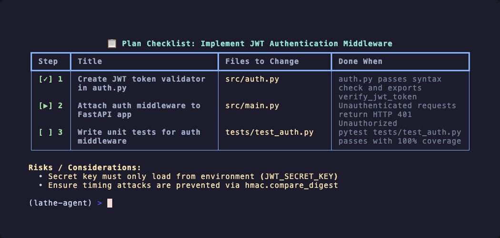

- **Tips**:
  - After each step, the Planner inspects the output and can dynamically revise, insert, or reorder subsequent steps.
  - Each step is executed with a focused context containing only the relevant files and summaries of previous milestones, preventing context window saturation.

---

### Automated Code Reviewer & Retry Loop

- **What it does**: After each step executed by the Coder, the Reviewer evaluates the unified diff and test suite output against five criteria:
  1. Correctness and alignment with step goals.
  2. Adherence to `done_when` criteria.
  3. Absence of unrelated or accidental changes.
  4. Absence of hardcoded API keys or secrets.
  5. Test suite execution passes.
- **When to use**: Dual mode automatically invokes the reviewer after every step. In single mode, enable self-check with `settings.self_check = true`.
- **Badge Outputs**:
  - `[ APPROVED ]` (Green): Step passed rubric; proceeds to next step.
  - `[ REVISE ]` (Yellow): Issues discovered; feedback is fed back to the Coder for up to 2 automatic retries.

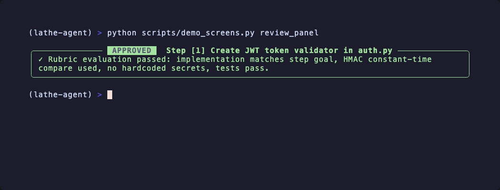

- **Tips**:
  - If tests fail, the Reviewer strictly enforces `REVISE`, preventing broken code from advancing.
  - If retries are exhausted, Lathe prompts you to keep the step, roll back via checkpoint, or take over manually.

---

### Intelligent Task Router

- **What it does**: Automatically analyzes your input and routes it to the optimal model and execution flow.
- **Routing Rules**:
  - **Chat**: User asks a conceptual question or explanation (`"Explain how async sessions work"`). Routed to Router or Coder model with read-only tools.
  - **Simple**: Single-file bug fix or minor edit (`"Fix typo in README"`). Routed to Single mode with Coder.
  - **Complex**: Multi-file refactoring or new module (`"Implement OAuth2 login with Google"`). Routed to Dual mode.
- **Exact Command**:
  Enabled by default when `settings.mode = "auto"`.
- **Tips**:
  - You can always override the router's decision by specifying `/mode single` or `/mode dual`.

---

### Workspace Tools

Lathe provides 14 deterministic workspace tools:

| Tool Name | Risk Level | Description |
| :--- | :--- | :--- |
| `read_file` | Read | Read file contents with line numbers and line range windowing. |
| `write_file` | Write | Create brand new files (fails if file already exists). |
| `edit_file` | Write | Perform atomic search-and-replace patches using surrounding context lines. |
| `list_dir` | Read | Render directory tree hierarchy up to a configured depth. |
| `glob` | Read | Locate files matching glob patterns (`src/**/*.py`) ignoring ignored directories. |
| `grep_search` | Read | High-speed regex and text search across files with context lines. |
| `semantic_search` | Read | Vector embedding search finding relevant code chunks by concept. |
| `run_shell` | Shell | Execute shell commands in the project root with timeout safety. |
| `run_tests` | Shell | Auto-detect and execute project test suite (pytest, cargo, npm, go, make). |
| `git_status` | Read | Inspect modified, staged, and untracked files in the workspace. |
| `git_diff` | Read | View unified diffs of working tree modifications. |
| `git_commit` | Write | Create conventional commits with verified task messages. |
| `git_log` | Read | View recent commit history, authors, and hashes. |
| `echo` | Read | Test connectivity and argument echoing. |

---

### Permission Engine & Always-Allow Rules

- **What it does**: Protects your system from unauthorized file writes and shell execution.
- **Authorization Options**:
  - `[y]es`: Approve this specific operation once.
  - `[n]o`: Deny this specific operation (tells model it was rejected).
  - `[a]lways`: Automatically allow operations matching this pattern for the rest of the project (saved to `.lathe/permissions.json`).
  - `[e]dit`: Edit the command string before execution.
  - `[d]eny with message`: Deny and send explanatory feedback to the model.

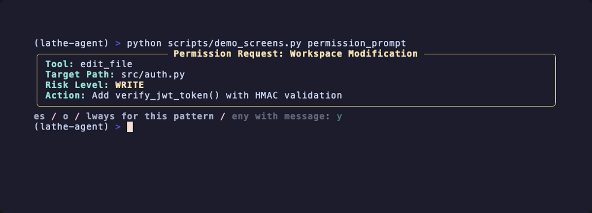

- **Tips**:
  - Always-allowed rules are stored locally in `.lathe/permissions.json` (e.g. `pytest*`, `ruff*`).
  - Never grants access outside the workspace root; directory traversal sequences (`../`) are rejected immediately.

---

### Git Checkpoints & Instant Undo

- **What it does**: Lathe creates an isolated shadow Git commit before every mutating operation.
- **Commands**:
  - `/diff`: Show unified diff of all changes made in the current session.
  - `/undo`: Revert the most recent modification.
  - `/checkpoints`: List all checkpoints created with timestamps and changed files.
  - `/restore <n>`: Restore the working directory to exact checkpoint `#n`.
- **Tips**:
  - Checkpoints do not clutter your standard Git branch history; they live in `.git/refs/lathe/checkpoints/`.

---

### Tree-Sitter Repository Symbol Map

- **What it does**: Uses Tree-sitter AST parsers to construct a high-density map of classes, methods, functions, and signatures across the repository within a strict token budget.
- **When to use**: Gives models global awareness of repository architecture without loading entire files into context.
- **Exact Command**:
  ```bash
  lathe map --budget 2048
  ```

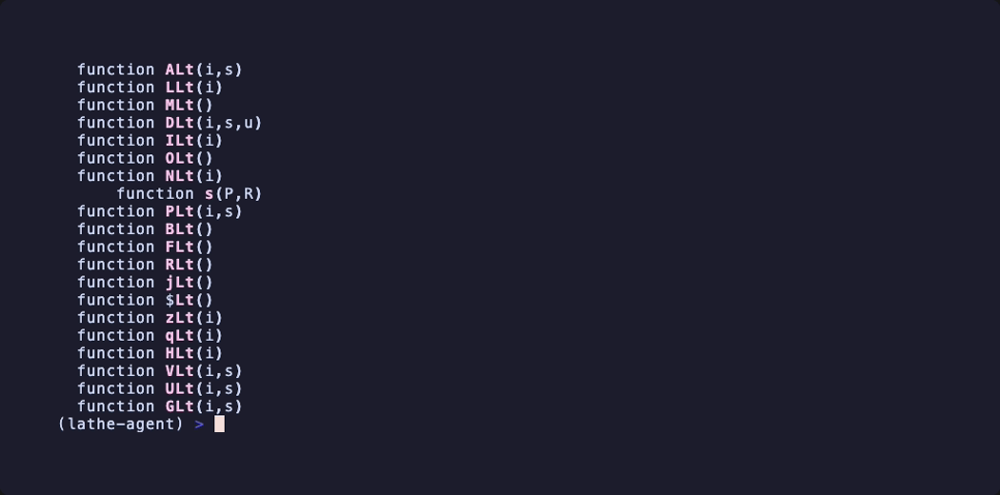

- **Tips**:
  - Automatically indexes Python, JavaScript, TypeScript, Rust, Go, C, C++, and Java files.
  - Respects `.gitignore` and `.latheignore`.

---

### Semantic Code Vector Indexing & Search

- **What it does**: Builds an incremental vector embedding index of repository code chunks in `.lathe/index/` using Ollama (`nomic-embed-text`) or Sentence Transformers.
- **Exact Commands**:
  ```bash
  lathe index          # Incrementally index modified files
  lathe index -r       # Rebuild index from scratch
  lathe index -s       # Display index statistics
  ```
- **Tips**:
  - Use `semantic_search` when you know *what* the code does conceptually but do not know variable or function names.

---

### Context Budget Allocation & Automatic Compaction

- **What it does**: Accurately counts tokens using Hugging Face tokenizers with fallback to `len/3.5`. Divides context into configurable shares (system prompt, repo map, pinned files, conversation, reply reserve).
- **Compaction Trigger**: When total token usage exceeds 75% of context window capacity:
  1. Older tool call outputs are compacted into one-line summaries.
  2. Old conversation turns are summarized by the Router model into a concise session digest.
  3. The user's original task and the latest 4 turns are preserved verbatim.
- **Commands**:
  - `/tokens`: Display current token budget allocation bar chart.
  - `/compact`: Force immediate context compaction.

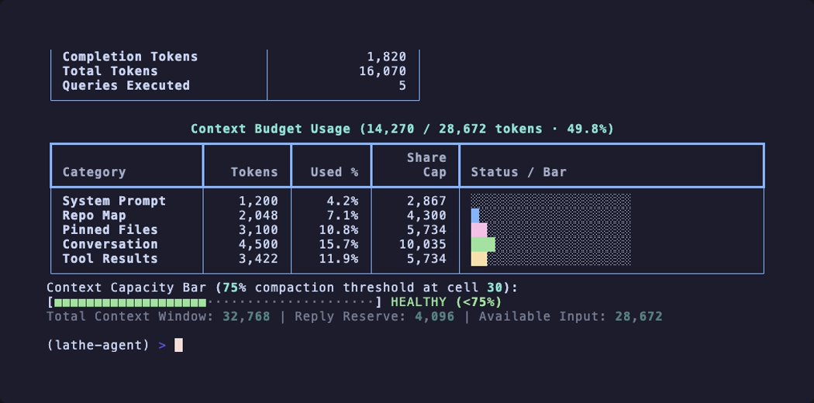

---

### Session Persistence & Resumption

- **What it does**: Every Lathe session is automatically persisted to `.lathe/sessions/<id>/` containing complete message history, plan state, checkpoints, and telemetry.
- **Exact Commands**:
  ```bash
  lathe --continue     # Continue the most recent session
  lathe --resume       # Pick a previous session from an interactive list
  ```
- **Tips**:
  - Use `/stats` to view token consumption, latency, and throughput per model role:

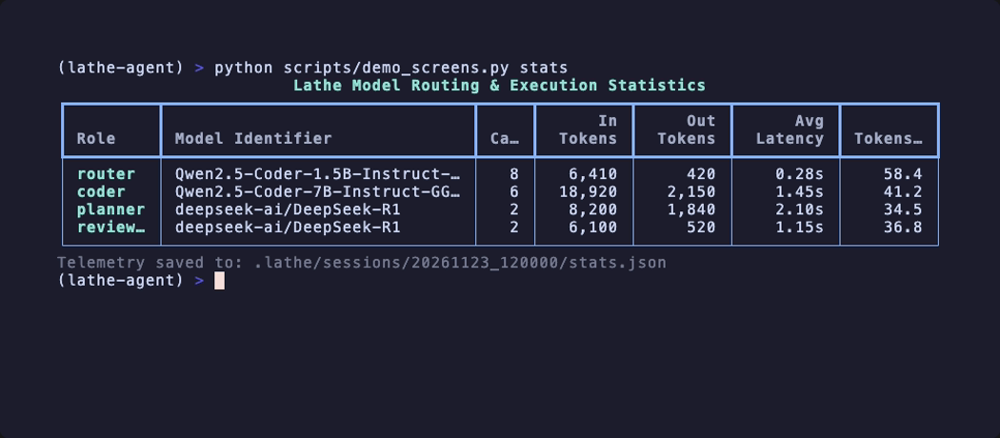

---

### LATHE.md Project Memory

- **What it does**: Project-level memory file (similar to `CLAUDE.md`) auto-loaded into the system prompt for every request.
- **Locations**:
  - Local: `./LATHE.md` at repository root.
  - Global: `~/.config/lathe/LATHE.md` for user-wide preferences.
- **Commands**:
  - `/init`: Explores your repository and writes a structured `LATHE.md` with build commands, test patterns, and style conventions.
  - `/remember <fact>`: Appends a new fact or preference to `LATHE.md` under `## Notes`.

---

### Custom Slash Commands

- **What it does**: Extend Lathe by creating Markdown files in `.lathe/commands/<name>.md`.
- **Example**:
  Create `.lathe/commands/review-pr.md`:
  ```markdown
  ---
  description: Review PR branch against main
  ---
  Inspect git diff main...HEAD. Verify code matches project conventions in LATHE.md, ensure unit tests exist, and check for security flaws.
  ```
- **Usage**:
  Type `/review-pr` in the REPL. Use `$ARGS` in command templates to pass dynamic command-line arguments.

---

### Model Management

Search, pull, probe, and select models directly from the CLI:

```bash
lathe models search "qwen2.5-coder"   # Search Hugging Face GGUF repositories
lathe models pull "hf.co/bartowski/Qwen2.5-Coder-7B-Instruct-GGUF:Q4_K_M"
lathe models probe "qwen2.5-coder:7b" # Probe tool calling and context capabilities
lathe models list                     # List local Ollama models and RAM requirements
lathe models use "qwen2.5-coder:7b"   # Set model as active coder in lathe.toml
```

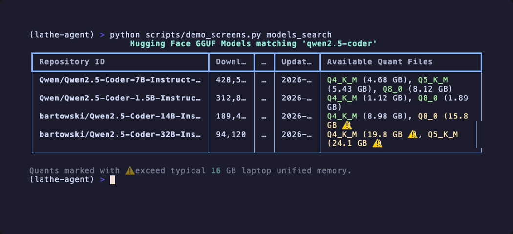

---

### Model Merging with mergekit

- **What it does**: Interactive wizard to combine two open-source LLM checkpoints into a hybrid model using `mergekit`.
- **Merge Methods**:
  - **SLERP**: Spherical Linear Interpolation for blending two models along geometric arcs.
  - **TIES**: Trims redundant task vectors and resolves sign interference.
  - **DARE-TIES**: Drop And REscale with interference resolution.
  - **Linear**: Weighted parameter averaging.
- **Commands**:
  ```bash
  lathe merge                 # Run interactive merge wizard
  lathe merge qwen-coder      # Merge using specific target directory name
  lathe merge --preset        # Start-small preset (Qwen2.5 1.5B Coder + Instruct)
  lathe merge --colab         # Export ready Google Colab notebook (.ipynb)
  lathe merge push <name>     # Upload merged weights to Hugging Face Hub
  ```

---

### GGUF Conversion & Ollama Integration

- **What it does**: Converts merged safetensors into quantized GGUF format using `llama.cpp`, generates an Ollama `Modelfile` with the correct chat template, registers it with `ollama create`, and runs capability probes.
- **Exact Command**:
  ```bash
  lathe merge gguf <name> --quant Q4_K_M
  ```

---

### Lathe Mini-Bench Evaluation Suite

- **What it does**: Built-in evaluation harness consisting of 30 isolated coding tasks (Python algorithms, C memory management, and tool calling) evaluated inside the sandbox.
- **Exact Command**:
  ```bash
  lathe bench                 # Run benchmark across candidate models
  lathe bench modelA modelB   # Compare specific models
  lathe bench --limit 5       # Run quick evaluation on 5 tasks
  ```

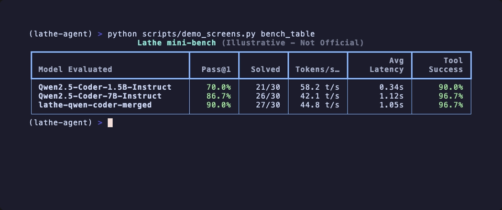

---

### Model Context Protocol (MCP) Client

- **What it does**: Connects Lathe to external MCP tool servers configured in `lathe.toml`.
- **Enable via CLI**:
  ```bash
  lathe --mcp
  ```
- **Configuration** in `lathe.toml`:
  ```toml
  [mcp]
  enabled = true

  [mcp.servers.filesystem]
  command = "npx"
  args = ["-y", "@modelcontextprotocol/server-filesystem", "/path/to/allowed/dir"]
  ```

---

## 7. Complete CLI Command Reference

### Root CLI Options (`lathe [OPTIONS] [COMMAND]`)

| Flag / Option | Type | Default | Description |
| :--- | :--- | :--- | :--- |
| `--version`, `-v` | Flag | `False` | Display Lathe package version and exit. |
| `--auto` | Flag | `False` | Auto-approve file writes; still prompt for shell execution. |
| `--yolo` | Flag | `False` | Approve all operations automatically (dangerous commands blocked). |
| `--dual` | Flag | `False` | Force Dual mode (Planner decomposes plan, Coder executes). |
| `--resume`, `-r` | Flag | `False` | Select and resume a previous session from interactive list. |
| `--continue`, `-c` | Flag | `False` | Resume the most recent session immediately. |
| `--mcp` | Flag | `False` | Enable Model Context Protocol (MCP) servers from lathe.toml. |
| `--help`, `-h` | Flag | `False` | Show CLI help message and exit. |

---

### Subcommands

#### `lathe doctor`
Run diagnostics checking Python version, Git executable, Ollama runtime, local models, and HF token.
```bash
lathe doctor
```

#### `lathe ask [PROMPT]`
Stream a completion for a prompt using Rich Markdown, measuring latency and tokens/sec.
```bash
lathe ask "Write a Python quicksort function" --role coder
lathe ask "Compare SLERP vs TIES merging" --role planner
```

#### `lathe map`
Print repository symbol map hierarchy and AST definitions.
```bash
lathe map [--budget 2048]
```

#### `lathe index`
Build or refresh semantic code vector index.
```bash
lathe index                  # Incremental update
lathe index --rebuild, -r    # Rebuild from scratch
lathe index --stats, -s      # Display index metrics
```

#### `lathe tools [NAME]` (Alias: `lathe tool`)
List all registered tools or inspect JSON schema and parameters for a specific tool.
```bash
lathe tools
lathe tool edit_file
```

#### `lathe bench [MODELS...]`
Run the Lathe mini-bench evaluation suite across models.
```bash
lathe bench
lathe bench qwen2.5-coder:7b lathe-merged
lathe bench --limit 10 --output-dir ./bench/results
```

#### `lathe config`
Inspect and manage configuration files.
```bash
lathe config path            # Print paths of global and project lathe.toml
lathe config show            # Display active merged TOML configuration
lathe config get <KEY>       # Read value (e.g. lathe config get settings.mode)
lathe config set <KEY> <VAL> # Write value (e.g. lathe config set settings.mode dual)
```

#### `lathe models`
Inspect and configure local and remote models.
```bash
lathe models search <QUERY>  # Search GGUF repositories on Hugging Face Hub
lathe models pull <REPO_ID>  # Download and register model in Ollama
lathe models list            # Show local Ollama models with RAM estimates
lathe models probe <MODEL>   # Test model tool calling and JSON capabilities
lathe models use <MODEL>     # Set model as active coder in lathe.toml
```

#### `lathe merge`
Interactive model merging wizard powered by mergekit.
```bash
lathe merge                  # Interactive merge wizard
lathe merge <NAME>           # Name merge output directory
lathe merge --preset         # Use start-small preset (Qwen 1.5B Coder + Instruct)
lathe merge --colab          # Generate Google Colab notebook (.ipynb)
lathe merge push <NAME>      # Upload merges/<NAME> to Hugging Face Hub
lathe merge gguf <NAME>      # Convert to GGUF, quantize, and import into Ollama
```

---

## 8. Complete Slash Command Reference

All slash commands available inside the interactive REPL:

| Command | Arguments | Description | Example |
| :--- | :--- | :--- | :--- |
| `/help` | None | Display table of all available slash commands and usage. | `/help` |
| `/init` | `[--force]` | Explore repository and generate initial `LATHE.md`. | `/init --force` |
| `/remember` | `<fact>` | Append project rule or preference to `LATHE.md` under `## Notes`. | `/remember Always use pytest for testing` |
| `/model` | `<role> <id>` | Switch model for role (`coder`, `planner`, `router`, `reviewer`). | `/model coder qwen2.5-coder:7b` |
| `/mode` | `single\|dual\|auto` | Switch active execution mode. | `/mode dual` |
| `/stats` | None | Show per-role call counts, latency, and tokens/sec metrics. | `/stats` |
| `/tokens` | None | Display token usage breakdown and colored budget bar chart. | `/tokens` |
| `/compact` | None | Force conversation compaction to reclaim token budget. | `/compact` |
| `/diff` | None | Display unified diff of all modifications made in session. | `/diff` |
| `/undo` | None | Restore workspace to the checkpoint taken before last action. | `/undo` |
| `/checkpoints` | None | List all session checkpoints with timestamps and changed files. | `/checkpoints` |
| `/restore` | `<number>` | Revert workspace to specific checkpoint number. | `/restore 2` |
| `/clear` | None | Clear terminal screen while preserving session context. | `/clear` |
| `/exit` | None | Gracefully exit Lathe REPL session (Ctrl+D). | `/exit` |

---

## 9. Configuration Reference (lathe.toml)

Lathe uses a two-level TOML configuration architecture:
1. **Global Configuration**: `~/.config/lathe/lathe.toml` (applies to all projects).
2. **Project Configuration**: `./lathe.toml` (overrides global configuration for current project).

> [!CAUTION]
> **Secret Isolation**: Secrets such as `HF_TOKEN` must **NEVER** be stored in `lathe.toml`. Lathe strictly forbids secret keys in configuration files and will raise a `ConfigError` upon load. Store secrets in environment variables or `.env`.

### Configuration Schema

#### `[settings]` Table
| Key | Type | Default | Description |
| :--- | :--- | :--- | :--- |
| `mode` | `str` | `"auto"` | Execution mode: `"auto"` (routed), `"single"`, or `"dual"`. |
| `max_agent_steps` | `int` | `25` | Maximum autonomous tool execution steps per request. |
| `repomap_token_budget` | `int` | `2048` | Maximum token budget allocated to repository symbol map. |
| `auto_approve_reads` | `bool` | `true` | Automatically allow read-only tools without prompting. |
| `blocked_commands` | `list[str]` | `["rm -rf /", ...]` | Shell command substrings forbidden by safety policy. |
| `theme` | `str` | `"lathe-dark"` | Terminal color theme palette. |
| `self_check` | `bool` | `false` | Enable automatic post-task test verification in single mode. |

#### `[roles.<role>]` Table (`planner`, `coder`, `reviewer`, `router`)
| Key | Type | Default | Description |
| :--- | :--- | :--- | :--- |
| `backend` | `str` | *Varies* | Backend provider: `"ollama"`, `"hf"`, or `"openai_compat"`. |
| `model` | `str` | *Varies* | Model identifier or Hugging Face repository string. |
| `temperature` | `float` | `0.2` | Generation temperature (`0.0` for deterministic tasks). |
| `max_tokens` | `int` | `4096` | Maximum generation tokens per turn. |
| `context_window` | `int` | `32768` | Model context window limit in tokens. |
| `base_url` | `str \| null` | `null` | Custom API base URL (e.g. `http://localhost:11434/v1`). |
| `provider` | `str` | `"auto"` | Hugging Face inference provider (`"auto"`, `"together"`, etc.). |
| `supports_tools` | `bool` | `true` | Whether backend supports native tool calling. |

#### `[embeddings]` Table
| Key | Type | Default | Description |
| :--- | :--- | :--- | :--- |
| `provider` | `str` | `"ollama"` | Embedding provider: `"ollama"`, `"sentence-transformers"`, `"hf"`. |
| `model` | `str` | `"nomic-embed-text"` | Vector embedding model identifier. |
| `base_url` | `str \| null` | `null` | Custom embedding API endpoint URL. |

#### `[project]` Table
| Key | Type | Default | Description |
| :--- | :--- | :--- | :--- |
| `test_command` | `str \| null` | `null` | Custom command to run test suite (e.g. `"pytest tests/unit"`). |

#### `[mcp]` Table
| Key | Type | Default | Description |
| :--- | :--- | :--- | :--- |
| `enabled` | `bool` | `false` | Enable Model Context Protocol server tool loading. |
| `servers.<name>` | `table` | `{}` | MCP server definitions with `command`, `args`, and `env`. |

---

### Full Example `lathe.toml`

```toml
# Lathe Configuration File
# Note: Secrets (HF_TOKEN) must NEVER be placed in this file; use environment variables or .env.

[settings]
mode = "auto"                  # "auto", "single", or "dual"
max_agent_steps = 25           # Guard against infinite loops
repomap_token_budget = 2048    # Tokens reserved for AST tree
auto_approve_reads = true      # Read tools require no prompt
theme = "lathe-dark"           # Rich terminal palette
self_check = true              # Verify tests after completion

blocked_commands = [
    "rm -rf /",
    "rm -rf ~",
    "git reset --hard",
    "mkfs",
    "dd if="
]

[roles.planner]
backend = "hf"
model = "deepseek-ai/DeepSeek-R1"
temperature = 0.6
max_tokens = 8192
context_window = 65536

[roles.coder]
backend = "ollama"
model = "hf.co/bartowski/Qwen2.5-Coder-7B-Instruct-GGUF:Q4_K_M"
temperature = 0.2
max_tokens = 4096
context_window = 32768

[roles.router]
backend = "ollama"
model = "hf.co/Qwen/Qwen2.5-Coder-1.5B-Instruct-GGUF:Q4_K_M"
temperature = 0.0
max_tokens = 1024
context_window = 8192

[embeddings]
provider = "ollama"
model = "nomic-embed-text"

[project]
test_command = "pytest tests/ -v"

[mcp]
enabled = false
```

---

## 10. Choosing & Sizing Models

### Hardware Tiers & Sizing

#### 8 GB RAM (MacBook Air M1/M2/M3 / Standard Laptops)
- **Configuration**: Single mode with `Qwen2.5-Coder-1.5B-Instruct-GGUF:Q4_K_M`.
- **Memory Footprint**: ~1.2 GB unified memory.
- **Planner**: Set `roles.planner.backend = "hf"` with a free Hugging Face API key so deep planning runs in cloud inference without consuming local RAM.

#### 16 GB RAM (MacBook Pro / Standard Dev Laptops) — *Recommended*
- **Configuration**: Auto mode.
  - Coder: `Qwen2.5-Coder-7B-Instruct-GGUF:Q4_K_M` (~4.8 GB).
  - Router: `Qwen2.5-Coder-1.5B-Instruct-GGUF:Q4_K_M` (~1.2 GB).
  - Planner: `DeepSeek-R1` via Hugging Face Serverless API or local 7B reasoning quant.
- **Memory Footprint**: ~6.0 GB total, leaving 10 GB for IDE and compilers.

#### 32 GB – 64 GB+ RAM (Mac Studio, Workstations, Multi-GPU)
- **Configuration**: 100% Offline Local Dual Mode.
  - Coder: `Qwen2.5-Coder-14B` or `32B` (`Q4_K_M` ~19 GB).
  - Planner: `DeepSeek-R1-Distill-Qwen-14B-GGUF` (~9 GB).
  - Router: `Qwen2.5-Coder-1.5B` (~1.2 GB).

---

### The "Sharded GGUF" Issue & How to Avoid It

> [!WARNING]
> **Sharded GGUF Repositories**: When browsing Hugging Face, some GGUF repositories split weights into multiple chunks (e.g. `model-00001-of-00004.gguf`). Ollama cannot directly pull or assemble sharded GGUF repositories via `hf.co/...` URL syntax, leading to `404 Not Found` or corrupt model errors.

**How to avoid it**:
Always select repositories that provide **single-file quantizations** up to 14B parameters. Repositories maintained by `bartowski` or official `Qwen` releases provide unified single-file GGUFs:
- ✅ **Recommended**: `hf.co/bartowski/Qwen2.5-Coder-7B-Instruct-GGUF:Q4_K_M`
- ✅ **Recommended**: `hf.co/Qwen/Qwen2.5-Coder-1.5B-Instruct-GGUF:Q4_K_M`
- ❌ **Avoid**: Multi-file split GGUFs (`*-00001-of-*.gguf`)

---

## 11. Safety, Threat Model & Blocked Commands

### What Lathe Will NEVER Do
1. **Never send telemetry**: Lathe transmits zero telemetry, code samples, or analytics to any remote server.
2. **Never leak secrets**: TOML configuration files strictly reject tokens or keys. Code scrubbers mask credentials in UI outputs.
3. **Never escape workspace**: Tool operations are strictly sandboxed within the project workspace root directory.
4. **Never execute destructive commands without warning**: Commands matching dangerous patterns are permanently blocked.

### Hard Blocklist

Lathe enforces an immutable security blocklist that rejects commands even if `--yolo` is specified:

```python
FORBIDDEN_PATTERNS = [
    r"\brm\s+-(?:r|f|rf|fr)\s+(?:/|~|\$HOME)\b",  # Recursive root/home deletion
    r"\bmkfs\b",  # Filesystem formatting
    r"\bdd\s+if=.*of=/dev/(?:sd|nvme|hd|vd)",  # Direct block device overwrites
    r":\(\)\s*\{\s*:\s*\|\s*:\s*&\s*\}\s*;",  # Shell fork bombs
    r"\b(?:bash|sh|zsh)\s+-i\s+>&",  # Reverse shells
    r"\bchmod\s+-[rR]\s+777\s+/\b",  # Global permissions wipe
    r"\bgit\s+reset\s+--hard\b",  # Destructive unstaged git wipe
]
```

### Checkpoint Undo Guarantee

Every write operation creates a Git shadow commit before applying changes. If a model generates malformed code or breaks project structure:
1. Type `/undo` to revert the last action.
2. Or run `/checkpoints` to view all saved restore points and `/restore <n>` to roll back to any point in time.

---

## 12. Troubleshooting & Error Recovery

| Issue / Error | Root Cause | Solution |
| :--- | :--- | :--- |
| **`Connection refused` on http://localhost:11434** | Ollama daemon is not running in background. | Run `ollama serve` in a separate terminal or launch Ollama app. |
| **`Model '...' not found`** | Requested model has not been pulled to local Ollama cache. | Run `lathe models pull <model_id>` or `ollama pull <model_id>`. |
| **`Secret '...' found in TOML file`** | You added `HF_TOKEN` or an API key to `lathe.toml`. | Remove token from `lathe.toml`. Export `export HF_TOKEN="hf_..."` or add to `.env`. |
| **`Role configured with backend='hf', but HF_TOKEN is not set`** | Planner or Coder is set to Hugging Face, but no token is detected. | Set `HF_TOKEN` in environment or `.env`, or switch role backend to `"ollama"`. |
| **`ModuleNotFoundError` after package update** | Old binary shim pointing to outdated wheel path. | Reinstall cleanly with `uv tool install lathe-agent --force`. |
| **Sharded GGUF download error** | Model repo split weights into multiple chunk files. | Choose a single-file quant (e.g. `hf.co/bartowski/...:Q4_K_M`). |
| **Windows execution policy error** | PowerShell prevents script execution. | Run `Set-ExecutionPolicy -ExecutionPolicy RemoteSigned -Scope CurrentUser`. |
| **Slow tokens/second throughput** | Model too large for GPU VRAM, spilling into CPU swap. | Switch to a smaller quant (`Q4_K_M` instead of `Q8_0`) or a 1.5B/7B model. |

---

## 13. Frequently Asked Questions (FAQ)

### Q: Does Lathe require an active internet connection?
**A**: No. If you use Ollama with local GGUF models (`Qwen2.5-Coder`), Lathe runs 100% offline with zero external network connectivity. Internet is only required if you explicitly choose the Hugging Face Serverless API backend (`backend = "hf"`).

### Q: Can Lathe edit multiple files at once?
**A**: Yes. In Dual Mode (`lathe --dual`), the Planner decomposes multi-file tasks into an ordered checklist, and the Coder applies atomic edits step-by-step.

### Q: How does Lathe prevent editing the wrong part of a file?
**A**: Lathe's `edit_file` tool requires surrounding context lines in the `old` block. If the context does not match uniquely, the patch is rejected without making partial modifications.

### Q: What is the difference between Single Mode and Dual Mode?
**A**: Single Mode uses one model for everything in a standard loop. Dual Mode splits planning and coding: a reasoning model constructs a verified plan, and a coding model executes each step with focused context and reviewer verification.

---

## 14. Keyboard Shortcuts

Available in the Lathe REPL:

| Shortcut | Action |
| :--- | :--- |
| `Enter` | Submit current prompt to Lathe. |
| `Alt+Enter` / `Esc Enter` | Insert newline without submitting. |
| `Tab` | Autocomplete slash commands and `@file` paths. |
| `@<filename>` | Trigger file auto-completion and pin file context. |
| `Ctrl+C` | Cancel ongoing LLM stream generation or command. |
| `Ctrl+D` | Exit Lathe session gracefully. |
| `Ctrl+L` | Clear terminal screen. |
| `Up` / `Down` Arrow | Navigate command and prompt history. |

---

## 15. Glossary of Terms

- **AST (Abstract Syntax Tree)**: Structural representation of source code parsed by Tree-sitter, used by Lathe to build the repository symbol map.
- **Compaction**: The process of summarizing older conversation turns and pruning tool outputs when context usage exceeds 75%.
- **DARE-TIES**: Model merging algorithm that drops redundant parameters and rescales remaining weights before resolving sign interference.
- **Dual-LLM Mode**: Orchestration strategy pairing a reasoning Planner with an implementation Coder.
- **GGUF**: Unified binary file format for storing quantized models for execution with `llama.cpp` and Ollama.
- **MCP (Model Context Protocol)**: Open standard for securely exposing tools, databases, and APIs to AI agents.
- **Quantization**: Compressing 16-bit floating-point weights into 4-bit (`Q4_K_M`) or 8-bit (`Q8_0`) representations to reduce RAM usage with minimal loss in accuracy.
- **SLERP (Spherical Linear Interpolation)**: Mathematical interpolation technique that blends two models along a high-dimensional spherical arc.
- **TIES**: Trimming, Resolving Interference, and Electing Sign — a model merging technique for combining task-specific checkpoints.

---

*Lathe User Manual · Version 0.1.0 · Generated with Playwright & VHS*
