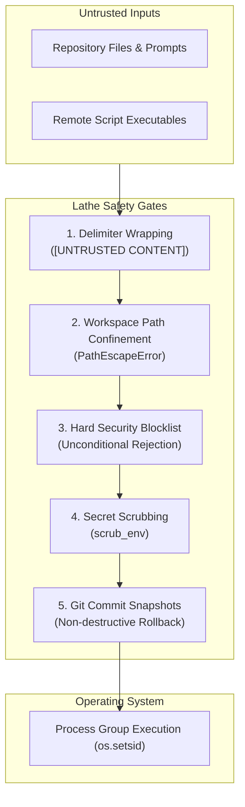

# Safety & Security

Autonomous coding agents require robust safety boundaries. Lathe implements a multi-tiered security architecture designed to prevent accidental data loss, shell command abuse, path traversal, credential leakage, and prompt injection attacks.

---

## Threat Model Overview

---

## 1. Hard Security Blocklist

Regardless of operational mode (even when running with `--auto` or `--yolo`), Lathe strictly rejects catastrophic command patterns:

- **Root & Home Deletion**: `rm -rf /`, `rm -rf ~`, `rm -rf $HOME`
- **Privilege Escalation**: `sudo`, `su`, `doas`
- **Remote Code Pipelines**: `curl ... | sh`, `wget ... | bash`, `fetch ... | zsh`
- **Disk Wiping**: `mkfs`, raw device `dd` targeting `/dev/*`
- **Dangerous Git Actions**: `git push --force`, `git clean -fdx`
- **System Tampering**: `chmod -R 777 /`, fork bombs (`:(){ :|:& };:`)

Blocklist violations trigger immediate rejection with structured feedback to the model.

---

## 2. Permission Engine Modes

Configure authorization behavior via `--mode` or `lathe.toml`:

### `default` (Interactive)
- **Read tools** (`read_file`, `list_dir`, `glob`, `grep_search`, `semantic_search`) run automatically.
- **Mutating tools** (`write_file`, `edit_file`, `run_shell`, `git_commit`) prompt the developer before execution:
  - `[y]es`: Allow this specific invocation once.
  - `[n]o`: Reject this tool call with feedback to the model.
  - `[a]lways`: Whitelist this command pattern for the rest of the project in `.lathe/permissions.json`.
  - `[e]dit`: Modify the shell command or file arguments interactively before running.
  - `[d]eny with message`: Provide explicit instructions explaining why the tool was rejected.

### `auto` (Autonomous)
Permits standard file edits and project test commands automatically while still actively enforcing the hard blocklist and workspace path boundaries.

### `yolo` (Unattended)
Runs non-interactively without prompting, while maintaining unconditional blocklist defenses.

---

## 3. Workspace Path Confinement

All file paths are resolved through `Workspace.resolve_path()`. Attempts to read or modify files outside the configured workspace root (e.g. `../../etc/passwd` or external symlinks) immediately raise `PathEscapeError` and halt the agent.

---

## 4. Secret Sanitization (`scrub_env`)

Subprocesses spawned by Lathe (`run_shell`, `run_tests`, git operations) execute in an isolated environment sanitized by `scrub_env()`. Any environment variable matching sensitive patterns (`*_KEY`, `*_SECRET`, `*_TOKEN`, `AWS_*`, `GITHUB_*`, `HF_*`) is stripped to prevent credential exfiltration.

---

## 5. Git Checkpoints & Non-Destructive Undo

Before executing any mutating file edit or shell tool, Lathe captures a git commit snapshot in an isolated reference (`refs/lathe/checkpoints/<session>/<n>`) using `git write-tree` without modifying your branch, staging area, or git reflog:

- `/diff`: View exact changes made by the agent since session inception.
- `/undo` or `lathe undo`: Instantly revert the workspace to the state prior to the agent's recent step.
- `/checkpoints`: View snapshot history with timestamps and descriptions.
